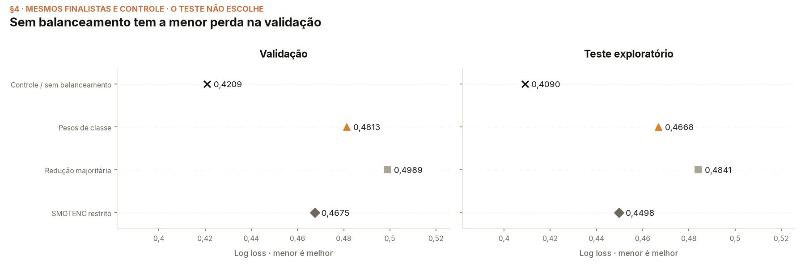
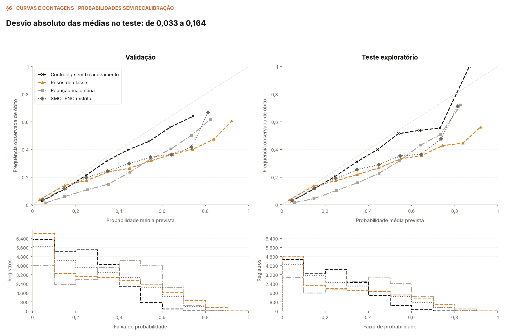
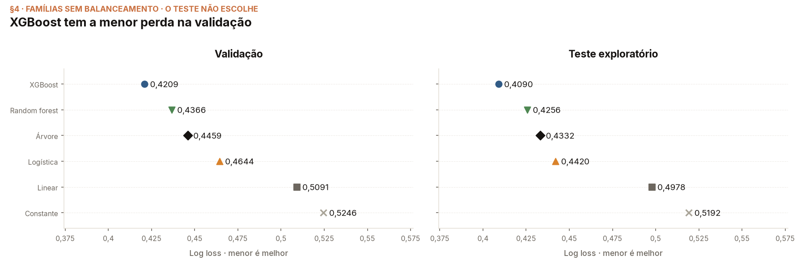
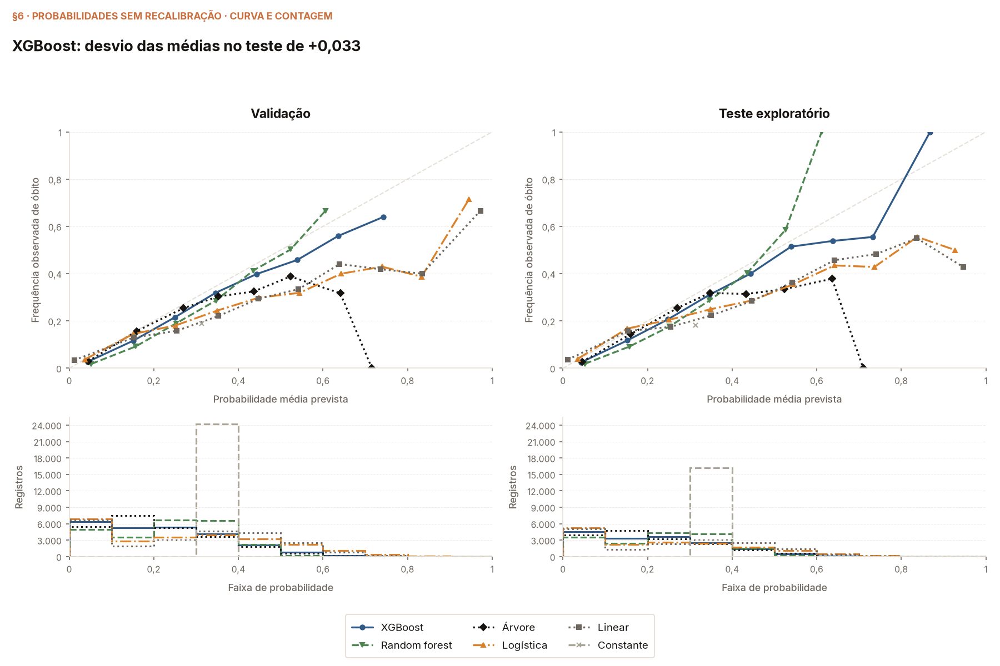

# Estudo do modelo do curso: balanceamento e seleção temporal

O estudo atual mantém a amostra de treino já registrada no módulo 00:
**200.000 registros** (internals do modelo §1). O objetivo é comparar XGBoost
sem balanceamento, com pesos de classe, com redução da classe majoritária e
com SMOTENC restrito, **ajustando os hiperparâmetros separadamente em cada
estratégia e usando log loss de validação como critério principal**.

A ampliação para todo o treino elegível foi **interrompida por decisão de
escopo antes da seleção final**. Seus checkpoints e seu protocolo permanecem
preservados; resultados parciais não constituem uma comparação concluída nem
um novo vencedor. Treinar na população elegível inteira continua sendo uma
possibilidade futura, não uma exigência para ensinar os métodos do curso.

A comparação foi concluída: **a configuração original sem balanceamento
continuou com o menor log loss de validação** entre os candidatos registrados
(walkthrough do balanceamento com ajuste §3). O resultado sustenta manter a
referência da aula sob esse critério; não demonstra que qualquer receita de
balanceamento seria pior. Os resultados já publicados continuam vinculados
ao preditor histórico, sem substituição automática do artefato nas aulas.

## Tarefa e população

O estudo é retrospectivo sobre registros de hospitalização da coorte COVID do
SIVEP-Gripe. O alvo distingue **óbito registrado no código 2 de cura registrada
no código 1 de `EVOLUCAO`**. Registros de óbito por outras causas, ignorados e
vazios não pertencem a esse alvo. O estudo não estima mortalidade por todas as
causas e não demonstra, por si só, utilidade clínica na admissão.

**Pergunta do modelo:** entre os registros dessa coorte, quão bem conseguimos
estimar a probabilidade do desfecho admitido usando as informações da ficha,
quando avaliamos períodos posteriores ao treino? O desfecho conhecido é a
resposta usada para conferir a previsão; não é fornecido como entrada do modelo.

**Pergunta da comparação:** balanceamento e ajuste de hiperparâmetros melhoram
a qualidade dessas probabilidades? **Pergunta posterior da PFI:** de quais
informações o desempenho do modelo escolhido depende? A sequência é definir
quem entra, construir e avaliar o modelo e, depois, investigar seu desempenho
com o preditor fixo.

Essa pergunta avalia previsão nos registros admitidos, **não qualidade do
tratamento hospitalar**. Pessoas sem hospitalização registrada não pertencem
à coorte; portanto, não estimamos o risco de óbito de todas as pessoas com
COVID. Diferenças de gravidade, composição e registro podem acompanhar
diferenças de desfecho. A PFI descreve o desempenho do preditor e não separa
o efeito causal da assistência dessas outras diferenças.

A receita da coorte permanece a do [manifesto Gold](gold/MANIFEST.md). O novo
estudo não redefine o alvo, inventa desfechos, corrige valores clínicos
desconhecidos nem transforma o estado `desconhecido` em `não`.
Notificações não são apresentadas como pessoas únicas; a separação por pessoa
não está demonstrada nesta extração.

### O que significa um registro elegível

**Elegível é o registro que passou pelos filtros da tarefa.** A palavra não
significa ficha inteiramente preenchida, pessoa escolhida para a amostra ou
paciente para quem já demonstramos utilidade clínica do modelo.

A receita exige, simultaneamente:

- **Hospitalização registrada**, junto de tosse ou dor de garganta **e**
  dispneia, baixa saturação ou desconforto respiratório. Dentro de cada
  grupo basta uma das condições; entre os grupos é necessário atender ambos.
- **COVID pela definição ampla:** marcação positiva molecular, marcação
  positiva de antígeno ou classificação final de COVID. Não exige confirmação
  exclusivamente por PCR.
- **Desfecho admitido:** cura ou óbito nos códigos da receita. Óbito por
  outras causas, desfecho ignorado e vazio são excluídos, não sobreviventes.
- **Início de sintomas desde 26/02/2020**, na extração estudada, e **idade
  disponível, calculada das datas de nascimento e início de sintomas e até
  120 anos**. O tratamento anterior
  considera idades negativas inválidas; a idade ausente é excluída.

Outras entradas podem estar ausentes e receber o tratamento declarado. Ter
vacinação registrada, por exemplo, não é requisito de entrada na coorte.
As condições completas e suas contagens estão no
[funil Gold](gold/MANIFEST.md#1-o-funil-na-ordem-em-que-os-filtros-correm),
com implementação na [Silver](../../tools/srag_30_silver.py) e no
[Ouro](../../tools/srag_40_gold.py).

Só depois desses filtros distinguimos **elegível para a coorte**,
**elegível no período de treino** e **efetivamente sorteado para treinar**.
Quem foi admitido na coorte em um período posterior pertence à validação ou
ao teste, não ao sorteio do treino.

## Divisão temporal e treinamento

O calendário separa os papéis dos dados antes de qualquer amostragem ou
balanceamento. O protocolo registra os limites exatos e as contagens lidas da
Gold. A amostra é retirada somente do período de treino e é compartilhada
entre as estratégias, antes de qualquer reamostragem. Ela não foi produzida
para equilibrar as classes e não é parte do procedimento da PFI.

A referência sem balanceamento e os candidatos com pesos usam as mesmas
linhas da amostra. A redução ou a síntese transformam apenas esse treino.
**Validação e teste temporais permanecem completos, com registros reais e a
distribuição observada das classes.** Nenhum deles recebe oversampling,
redução de classe ou exemplos sintéticos. O restante do treino elegível não
é incorporado à avaliação.

### De onde vêm os tamanhos dos conjuntos

Primeiro separamos pelo ano civil de início dos sintomas (`DT_SIN_PRI`);
só depois sorteamos o treino. Os tamanhos não são cotas de uma divisão
percentual fixa.

| Papel | Período | Registros elegíveis | Uso no estudo |
|---|---|---:|---|
| Treino | 2020–2022 | 1.242.680 | Amostra aleatória de 200.000 |
| Validação | 2023 | 24.148 | Todos os registros elegíveis |
| Teste histórico | 2024 | 16.142 | Todos os registros elegíveis |

As contagens são impressas no módulo 00, walkthrough do modelo §1 e internals
do modelo §1. O número da amostra é uma decisão operacional de tempo e
distribuição do material; não resulta de um cálculo de tamanho mínimo ou ótimo.
O sorteio é uniforme, sem reposição, no período de treino inteiro e com semente
registrada. Não impõe a mesma quantidade por ano nem equilibra as classes.

Os tamanhos de validação e teste resultam dos registros admitidos pela receita
em cada ano; não foram escolhidos para obter uma proporção desejada. O desenho
reserva um período posterior para seleção e outro ainda posterior para
avaliação. Essa cronologia é uma escolha do estudo, não prova que sejam os
únicos cortes adequados. A diferença de contagens não demonstra sozinha a
causa epidemiológica ou administrativa dessa diferença.

O sorteio uniforme dentro do treino não elimina mudança de distribuição entre
períodos. A PFI da aula é global porque resume o erro no conjunto avaliado;
ela não exige usar toda a coorte disponível. Suas fichas visíveis ilustram a
operação, enquanto os indicadores usam o teste inteiro.

## Critério e comparação

É preciso distinguir os estudos, pois suas perguntas são diferentes:

- A [seleção histórica](SELECTION.md) compara famílias e configurações pelo
  critério de AUC da validação. Ela estabeleceu a referência usada nas aulas.
- A [comparação anterior de balanceamento](notebooks/srag_balance_comparison.ipynb),
  executada por `tools/srag_61_balance.py`, mantém a configuração do XGBoost
  fixa. Ela mede o efeito das estratégias sob aquela configuração; não
  demonstra qual seria o melhor modelo ajustado dentro de cada estratégia.
- O estudo atual mantém a família XGBoost e a amostra, mas permite ajuste de
  hiperparâmetros em cada estratégia. A grade controlada e seu orçamento
  precisam ser declarados antes dos ajustes; a escolha usa somente o menor
  log loss de validação. A comparação inclui a estratégia sem balanceamento,
  sem presumir que balancear melhorará o resultado.

O protocolo novo deve registrar a origem da amostra, as variáveis, os limites
temporais, as versões da pilha, as sementes e todas as configurações. As regras
de desempate também devem ser explícitas. A validação escolhe a configuração
de cada estratégia e, depois, a referência entre as configurações escolhidas.
Isso compara as melhores opções encontradas no espaço declarado; não isola
o efeito do balanceamento mantendo todos os outros parâmetros fixos e não
demonstra superioridade universal.

O SMOTENC restrito reconstitui o calendário e rejeita propostas que violem as
restrições declaradas; não é apresentado como o algoritmo sem modificações.
O protocolo deve conservar essa identificação e explicitar a preparação
reutilizada entre ajustes, sem misturar validação ou teste ao treino.

**Reconhecer e estudar o desbalanceamento não obriga a tornar as classes
igualmente frequentes.** A frequência artificial do treino pode alterar as
probabilidades; por isso a
comparação usa log loss e avaliação na distribuição real.

### Resultado da comparação concluída

Foram avaliadas **30 configurações por estratégia, 120 ajustes no total**.
A configuração original também participou de cada estratégia; não foi
retirada da disputa (walkthrough do balanceamento com ajuste §2; internals §2).

| Melhor configuração de cada estratégia | Log loss — validação | Log loss — teste histórico |
|---|---:|---:|
| Sem balanceamento, configuração original | **0,4209** | **0,4090** |
| Pesos de classe | 0,4813 | 0,4668 |
| Redução da majoritária | 0,4989 | 0,4841 |
| SMOTENC restrito | 0,4675 | 0,4498 |

Fonte: walkthrough do balanceamento com ajuste §3–§4. Menor é melhor.
O teste não escolheu o vencedor. Pesos e redução escolheram parâmetros
diferentes dos originais; o melhor SMOTENC restrito manteve a configuração
original. Retunar essas receitas não as fez superar a referência na validação.

Os gráficos mostram também a mudança da perda frente à referência e as
curvas de calibração com suas contagens (walkthrough §5–§6). Nas receitas
avaliadas, aumentar a detecção de óbitos no limiar descritivo veio acompanhado
de mais falsos alertas e pior log loss. A configuração original também
superestima a frequência média: vencer essa comparação não significa ter
probabilidades perfeitamente calibradas.

A [figura de ganhos frente à referência](figures/sample-balance-gains-control.png)
complementa a leitura, mantendo zero como referência de ausência de melhoria.

A conclusão é condicionada à amostra, aos períodos, ao espaço finito de
parâmetros, às receitas de balanceamento e às probabilidades sem recalibração.
Não é uma demonstração de que balancear sempre piora, nem uma comparação de
todas as famílias de modelo.

## Comparação entre famílias por log loss

A nova rodada por família usa a mesma amostra registrada e os mesmos períodos,
com as classes na distribuição observada. Ela responde qual configuração,
entre as candidatas declaradas, tem menor log loss de validação. O estudo de
balanceamento do XGBoost acima continua separado; não é uma comparação de
receitas de balanceamento em todas as famílias.

O executor `srag_54_sample_family_search.py` preserva os espaços históricos,
mas refaz a seleção pelo **log loss sem arredondar**, com pré-processamento
aprendido somente no treino. Os orçamentos são declarados por família, não
iguais: referências constante e linear, logística, árvore, floresta e XGBoost.
As referências constante e linear não têm uma busca de hiperparâmetros. O
modelo linear continua sendo OLS, com probabilidades limitadas ao intervalo
declarado para calcular a perda; não passa a ser um modelo treinado por log
loss. A floresta conserva o número de árvores como orçamento fixo do executor.

O protocolo congela amostra, entradas, versões, código, candidatos e desempate
antes dos novos ajustes. A validação escolhe o finalista de cada família e o
vencedor; todos são congelados antes das novas previsões de teste. O teste já
observado permanece exploratório e não muda a escolha. Não há recalibração,
retreino com validação ou mudança silenciosa do preditor explicado nas aulas.

Os candidatos sem balanceamento do XGBoost podem ser reaproveitados do estudo
anterior somente após conferir a igualdade dos dados, preparação, configurações,
ambiente e métricas recompostas dos checkpoints assinados. A importação fica
declarada no protocolo; o executor recusa divergências. As demais famílias
recebem novos ajustes e checkpoints próprios. O reaproveitamento não é
apresentado como uma nova execução desses candidatos.

Esta rodada não isola apenas a mudança de AUC para log loss: a preparação
histórica também tinha uma construção de vocabulário diferente. Por isso os
resultados antigos ficam identificados como históricos, e os novos pertencem
a este protocolo. Uma busca finita com orçamentos distintos não demonstra
qual seria a melhor família sob otimização irrestrita.

### Resultado da seleção por log loss

O [walkthrough de famílias](notebooks/srag_sample_family_walkthrough.ipynb)
imprime os orçamentos e a origem dos candidatos (§2–§3), as perdas dos
finalistas (§4) e a escolha congelada (§5). Foram **73 configurações**:
**43 novos ajustes** e **30 candidatos XGBoost reaproveitados e conferidos**.
A floresta mantém **300 árvores** como orçamento fixo (§2), sem apresentar
esse parâmetro como ajustado pela busca.

| Finalista de cada família | Log loss — validação | Log loss — teste histórico |
|---|---:|---:|
| **XGBoost** | **0,4209** | **0,4090** |
| Random forest | 0,4366 | 0,4256 |
| Árvore de decisão | 0,4459 | 0,4332 |
| Regressão logística | 0,4644 | 0,4420 |
| Modelo linear de probabilidade (OLS limitado) | 0,5091 | 0,4978 |
| Previsão constante | 0,5246 | 0,5192 |

**O XGBoost continua selecionado**, com os parâmetros da referência original.
As configurações selecionadas de árvore e floresta mudaram frente ao registro
histórico. A tabela é a comparação entre finalistas pela validação; o teste
exploratório não muda a escolha (walkthrough de famílias §4–§5 e §7).

As curvas e as contagens por faixa complementam essa comparação. O XGBoost
ainda superestima o desfecho em média no teste; menor log loss entre os
candidatos não certifica calibração perfeita (walkthrough de famílias §6).

O [caderno de auditoria](notebooks/srag_sample_family_internals.ipynb)
confere a amostra, o protocolo, as assinaturas e as escolhas do agregado.
As previsões individuais ficam fora do repositório público. A apresentação
mantém identificada a referência histórica explicada pela PFI; esta busca
não é apresentada como uma nova execução de todas as suas permutações.

## Pré-processamento e avaliação

O vocabulário das categorias, a imputação, a padronização e os amostradores
são ajustados somente com o treino. Categorias novas na avaliação têm uma
regra explícita. O pipeline salvo inclui essas transformações, evitando que
cada aula reconstrua uma versão diferente do preditor.

ROC-AUC, average precision, Brier e curvas de calibração complementam o critério
principal. Log loss e Brier avaliam previsões probabilísticas; não isolam a
calibração. Sensibilidade e especificidade em um limiar descritivo não são uma
escolha de política clínica.

Nesta rodada, as probabilidades são avaliadas **sem recalibração**. Uma
comparação futura de calibradores precisaria separar os dados usados para
ajustá-los dos dados usados para selecionar e avaliar, preservando a ordem
temporal.

O teste histórico já foi observado em estudos anteriores. O novo procedimento
não o usa para escolher o vencedor, mas sua reutilização continua sendo um
**backtest exploratório**, não uma confirmação independente. Novas decisões
baseadas nele exigem essa mesma identificação.

## Modelo único e adoção nas aulas

A seleção é congelada antes de calcular os resultados do teste. O artefato
canônico inclui o pipeline treinado, os hiperparâmetros e o hash do protocolo.
Modelos e caches ficam fora do repositório; as fontes, os resultados agregados
e a identificação da versão ficam versionados.

A PFI vem depois do treinamento e da seleção: altera as entradas de avaliação
com o preditor fixo. Trocar o modelo exige recalcular as explicações, o exemplar
quando aplicável, as figuras e os textos dependentes. Uma diferença pequena de
AUC entre modelos não autoriza transferir previsões ou importâncias.

A cobertura didática segue a numeração própria do repositório: a PFI está no
módulo 06 e corresponde ao capítulo 23 de Molnar. Isso não significa que todos
os capítulos intermediários já tenham sido implementados. A síntese ampliada
fica no [relatório do modelo global e PFI](../../reports/02-modelo-global-pfi/README.md).

### Critério para chamar uma aula de migrada

A adoção exige consultar o pipeline congelado diretamente nas entradas brutas,
por uma interface que confira a identidade do novo protocolo amostrado. O
[loader da referência](../../tools/srag_63_course_reference.py), desenvolvido
para o estudo no treino completo, também precisa dessa compatibilidade
verificada; sua presença não demonstra que o novo estudo já pode ser carregado.
O helper histórico distingue a codificação pela classe Python do estimador:
um wrapper genérico não é reconhecido por aquela heurística.

| Método | Conferência exigida antes da adoção |
|---|---|
| Ceteris paribus e ICE | Usar o preditor carregado, selecionar novamente exemplares e painéis declarados e recalcular curvas e conclusões. Experimentos de retreinamento ficam identificados como estudos separados. |
| LIME | Reconstruir as entradas brutas sem perda e consultar o mesmo pipeline; revisar as frequências da vizinhança. O ajuste do explicador local permanece, pois ele não é o preditor explicado. |
| Contrafactuais | Recalcular exemplar e candidatos, manter o calendário coerente ao alterar o tempo e tratar explicitamente a ausência de candidatos ou soluções. |
| SHAP | Conferir a codificação, a escala e a soma das atribuições do novo XGBoost. Compartilhar a família do modelo histórico não permite reutilizar as atribuições antigas. |
| PFI | Recalcular perdas, ordens, ranking e janela didática; atualizar gráfico, probabilidades e metadados juntos. A igualdade com probabilidades históricas não é um requisito para um modelo novo. |

Cada caderno adotado deve imprimir a identificação do mesmo modelo e produzir
novamente seus próprios resultados. Compartilhar o preditor não obriga todos
os métodos a explicarem a mesma pessoa ou a usarem o mesmo conjunto de apoio.
Um background de explicação declarado também não reduz retroativamente os
dados com que o preditor foi treinado.

## Evidência e reprodução

Os executores `tools/srag_51_course_study.py` e
`tools/srag_52_course_balance.py` e seus checkpoints preservam a tentativa
interrompida no treino completo. O novo executor é
`tools/srag_53_sample_balance_search.py`, com o
[agregado concluído](gold/sample_balance_search.json). A configuração histórica de
`tools/srag_61_balance.py` permanece inalterada. Protocolos e artefatos de
estudos diferentes não são intercambiáveis.

O [walkthrough do estudo](notebooks/srag_course_study_walkthrough.ipynb) e o
[internals](notebooks/srag_course_study_internals.ipynb) acompanham o registro
do estudo interrompido; `gold/course_study_v2.json` deve comunicar esse estado.
Para a comparação atual, o
[walkthrough do balanceamento com ajuste](notebooks/srag_sample_balance_walkthrough.ipynb)
e seu [internals](notebooks/srag_sample_balance_internals.ipynb) imprimem a
identificação, as verificações e os resultados medidos. O novo estudo é uma
comparação; não troca o preditor das aulas silenciosamente. Modelos treinados e
caches permanecem fora do repositório; fontes e evidência agregada identificada
ficam versionadas. A busca não roda silenciosamente ao abrir um notebook de aula.

Referências metodológicas: [métricas conforme o objetivo](https://scikit-learn.org/stable/modules/model_evaluation.html#which-scoring-function-should-i-use),
[calibração](https://scikit-learn.org/stable/modules/calibration.html) e
[reamostragem somente no treino](https://imbalanced-learn.org/stable/common_pitfalls.html).
