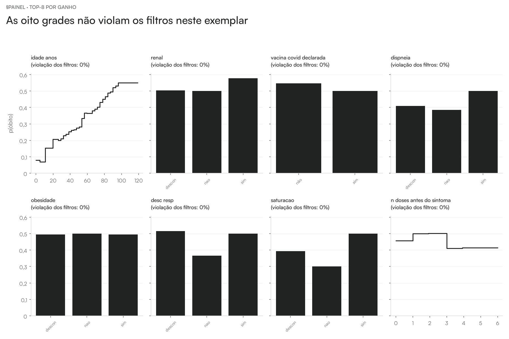

# Módulo 01 — Ceteris paribus

*Autor do módulo: [William Bendinelli](https://github.com/wbendinelli) — SCC5819 (ICMC-USP, 2026).*

Perfis ceteris paribus — Molnar, cap. 12 — sobre o XGBoost SRAG/COVID da
[referência do curso](../00-dataset/MODEL.md). Substituímos uma entrada de um
registro, mantemos as outras fixas e consultamos a probabilidade prevista.
A pergunta é sobre o preditor; a operação não identifica um efeito clínico.

## Objetivos de aprendizagem

1. Construir um perfil e declarar exemplar, grade, escala e entradas congeladas.
2. Distinguir os cortes do modelo dos saltos observados em uma grade.
3. Contar violações das regras auditadas, sem tratá-las como toda a plausibilidade clínica.
4. Avaliar o que resta da comparação após restringir a grade ao suporte declarado.

## Por que o método mais simples vem primeiro

O perfil consulta diretamente o modelo, sem ajustar um substituto. Isso permite
examinar as combinações entregues ao preditor antes de agregar curvas ou ajustar
outra explicação. Os dois exemplares são escolhidos por regras declaradas;
não representam a população inteira.

AUC 0,7644 e Brier 0,1308 no teste descrevem o desempenho do XGBoost; a logística
obtém 0,7246 e 0,1452 na mesma avaliação (walkthrough, setup). A comparação entre
famílias não isola quanto da diferença se deve a interações.

## O que o módulo mostra

- **Grade (§1):** neste perfil de idade, a amplitude é 0,4809 nas quatro
  resoluções. O maior salto passa de 0,1387 para 0,0852 e estabiliza nas grades
  examinadas (internals §1). Outra grade pode deixar de conter os extremos.
- **Modelos (§1b):** no mesmo exemplar, as amplitudes da idade são 0,481 no
  XGBoost e 0,397 na logística. Em doses, o XGBoost termina abaixo do início
  (−0,044), mas a diferença regional no exemplar é positiva (+0,03542,
  internals §4). Forma e direção dependem do intervalo.
- **Regras (§2):** comorbidades, calendário e critérios da coorte produzem
  contagens diferentes por registro. Na amostra, as frações expostas são
  37,3% no portão, 29,7% no calendário e 79,6% no critério-2.
- **Distância (§3):** o exemplo com violação fica a Gower 0,0037 do vizinho;
  o exemplo sem essa violação, a 0,1287. A mediana nos registros reais é
  0,0046. Distância pequena não garante conformidade com os filtros.
- **Restrição (§4):** no exemplar pré-campanha, restam apenas doses ausentes;
  a amplitude passa de 0,0119 a 0,0000. Não há uma curva de comparação entre
  doses nessa grade restrita. O outro exemplar conserva amplitude 0,0896.

## O que o módulo conclui, e como isso é medido

O CP mostra a resposta do modelo às substituições declaradas. A leitura exige
suporte e verificação das combinações; passar pelos filtros implementados
não certifica um perfil clínico como possível. O feixe ICE do módulo 02 amplia
a comparação para vários registros.

A análise de sementes do internals §2 é uma **ablação de 150 árvores**,
comparada à referência de **800 árvores**. Sem subamostragem, os perfis
coincidem nas sementes examinadas; ao ativar `subsample` e `colsample_bytree`
com 0,8, aparecem diferenças. A correlação mediana 0,9978 pertence à ablação,
não a retreinos do modelo de referência. O caderno imprime os dois orçamentos,
a igualdade dos perfis e o SD de cada regime.

**Correções de interpretação desta revisão.** A redação anterior atribuía a
diferença de AUC exclusivamente a interações e chamava o perfil de doses de
medida de confundimento. Essas causas não foram isoladas. Também identificava
o ensaio de sementes como configuração do curso e dizia que os degraus variavam
sem subamostragem. A ablação e seus regimes agora estão separados. A diferença
finita regional do CP é comparável a um diagnóstico do LIME; não é, em geral,
o coeficiente de sua regressão multivariada.

Histórico das medições e correções

### O que ficou registrado como corrigido

A barra de evidência (regra 3) manda o valor antigo ficar no registro
quando a medição derruba a prosa. As quatro desta revisão:

- **A amplitude não converge com a grade — ela nunca se moveu.** Esta
  página dizia que refinar do passo 10 ao passo 1 movia a amplitude de
  0,288 para 0,331; no modelo do curso ela é 0,4809 nos quatro passos
  (internals §1). O que a grade move é o degrau aparente (0,1387 → 0,0852,
  até parar de mover), e a lição — posições de corte primeiro, alturas só
  depois que a grade parou de mudá-las — sai mais limpa do que entrou.
- **A rampa não é a mais agressiva.** A prosa dizia que a logística
  varria mais que a escadaria na idade (amplitude 0,718 contra 0,330).
  Medido (walkthrough §1b), é o contrário: 0,481 da escadaria contra
  0,397 da rampa. O que sobrevive da comparação é a **forma** — no escore
  aditivo da logística, a transformação desenha a mesma curva em S para todo paciente,
  deslocada ao longo do eixo pelo resto da ficha, o que no trecho visível
  muda altura e inclinação —, não o tamanho.
- **"O XGBoost desce nas doses" era ler a ponta, não o paciente.** A
  prosa dizia que os dois modelos discordavam de direção, a logística
  subindo e o XGBoost descendo de leve. O desacordo sobrevive ponta a
  ponta (+0,217 contra −0,044), mas o perfil do XGBoost **não é
  monótono**: sobe até a segunda dose e só então cai, e a inclinação
  local no próprio paciente é positiva (+0,03542, internals §4).
- **Os números de Gower já estavam errados antes da troca de modelo.**
  Esta página e o outline citavam 0,043 no ponto impossível, 0,130 no
  possível e 0,005 na mediana dos reais; a célula commitada imprimia
  0,0491, 0,1364 e 0,0046 — a prosa nunca bateu com o caderno. No
  modelo do curso os valores são 0,0037, 0,1287 e 0,0046, e o achado
  ficou mais forte: o ponto impossível está mais perto de um paciente
  real do que o paciente real mediano está do vizinho dele.

Uma correção de citação, na mesma passada: o caderno imprimia as frações
da base cheia como 38,07 / 34,51 / 78,83 / 23,67% apontando para o
"internals §6 do modelo". O módulo 00 mede 38,05 / 34,50 / 78,83 /
23,66% e a seção é a **§5** (as quatro impossibilidades); a linha
impressa foi corrigida.

## Aula

[Roteiro vivo](lecture/outline.md): sequência das figuras, perguntas e limites.

## Notebooks

- [Walkthrough](notebooks/cp_walkthrough.ipynb): modelo de referência, perfis,
  exemplares, filtros e restrição da grade.
- [Internals](notebooks/cp_internals.ipynb): resolução, ablação de sementes,
  violações por entrada e diferenças finitas regionais.

Os cadernos usam a amostra distribuída e o perfil visual SAPIANS Global / VITA.
A instalação requer rede quando as dependências ainda não estão disponíveis.
As figuras são geradas em uma pasta temporária externa; as cópias de `figures/`
são promovidas explicitamente.

## Referências

- Molnar, C. *Interpretable Machine Learning*, 3ª ed. — [cap. 12 (Ceteris Paribus)](https://christophm.github.io/interpretable-ml-book/ceteris-paribus.html). (Livro-texto: a definição, a comparação entre modelos da fig. 12.5, a limitação das combinações irreais e a advertência causal.)
- Base, modelo, pacientes e cercas: módulo 00 ([MODEL.md](../00-dataset/MODEL.md), [GOLD.md](../00-dataset/GOLD.md), [gold/MANIFEST.md](../00-dataset/gold/MANIFEST.md)).
