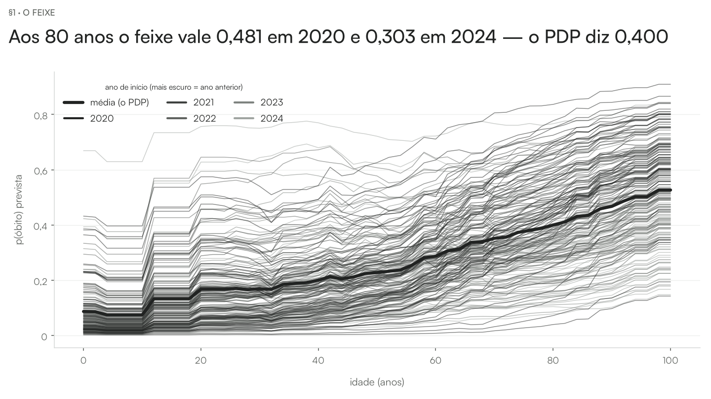

# Módulo 02 — ICE (expectativa condicional individual)

*Autor do módulo: [William Bendinelli](https://github.com/wbendinelli) — SCC5819 (ICMC-USP, 2026).*

Curvas ICE — Molnar, cap. 13; Goldstein et al. (2015) — sobre a
[referência SRAG/COVID](../00-dataset/MODEL.md). Um perfil por registro permite
comparar respostas individuais e sua média. As diferenças por ano organizam a
leitura deste painel, sem identificar uma causa temporal para a heterogeneidade.

## Objetivos de aprendizagem

1. Construir ICE e PDP no mesmo painel, com amostragem e ponderação explícitas.
2. Usar c-ICE para comparar curvas ancoradas, distinguindo correlação e igualdade de forma.
3. Calcular diferenças finitas Δp/Δidade e conferir sensibilidade à grade.
4. Contar violações dos filtros auditados e delimitar seu alcance.

## Por que um feixe, e não uma curva

A curva de um exemplar não descreve todos os registros. Neste estudo, o painel
contém **200 registros, 40 por ano, semente 42**. Essa escolha equilibra os anos
para comparação visual; não reproduz suas frequências na coorte (walkthrough,
setup). Cada curva parte de uma notificação observada e avalia substituições
artificiais, mantendo as outras entradas fixas.

## O que o módulo mostra

1. **Feixe e média (§1):** aos 80 anos, as médias são 0,481 nos registros de
   2020, 0,317 nos de 2023 e 0,303 nos de 2024; o PDP do painel é 0,400.
   São referências diferentes. A cor por ano não controla as outras entradas.
2. **Curvas centradas (§2):** o ganho 0→100 vai de 0,247 (p10) a 0,623 (p90),
   com correlação mediana de 0,983 com a média (internals §2). Correlação alta
   não demonstra igualdade das curvas nem ausência de interação.
3. **Filtros (§3):** idade não viola as regras examinadas (0/10.200 pontos);
   doses produz 252/1.400 violações (18% = 42 registros pré-campanha × 6).
   Em tosse, a fração é 54% (internals §3). Uma contagem nula não certifica
   toda a plausibilidade clínica das substituições.
4. **Diferenças finitas (§4):** na grade principal, o máximo mediano de
   Δp/Δidade é 0,0239 por ano no intervalo iniciado aos 10 anos; a mediana
   no miolo 40–54 é 0,00326 e o máximo após 55 é 0,0133. O caderno confere
   passos de **1, 2 e 5 anos**, no mesmo modelo e painel, antes de interpretar
   posição ou altura do máximo.

## O que o módulo conclui, e como isso é medido

ICE revela diferenças entre previsões que uma média resume. Centrar remove a
âncora de nível; não torna as formas iguais. Separação por cor ou correlação
entre curvas não prova um mecanismo de regime ou uma interação clínica.

Para árvores, Δp/Δidade é um quociente em intervalos da grade, não uma derivada
analítica suave. As proporções observadas de óbito no treino — de 3,49%
(4–8 anos) a 13,89% (16–20), com 292 a 720 registros por faixa — descrevem
suporte e associação; não explicam causalmente o pico das previsões (§4).

**Correção de interpretação.** A versão anterior chamava esse máximo de
“efeito biológico” e “braço adolescente da curva em U”. As medidas da grade e
as contagens observadas permanecem registradas; elas não isolam esse mecanismo.
Também chamava a média de “mentira” e um PDP de pequena amplitude de prova de
pouco uso de uma entrada. Uma média pode ocultar respostas individuais sem
estar incorreta; sua amplitude isolada não mede a importância da entrada.

Histórico de condicionamento das medições

Todos os números acima são do modelo do curso adotado em 2026-09-01 (800
árvores, profundidade 4, lr 0,05 — módulo 00,
[SELECTION.md](../00-dataset/SELECTION.md)); a versão anterior deste
módulo os media no modelo de 400 árvores / profundidade 5. O
deslocamento é de condicionamento, não de falsificação: as medidas foram preservadas, mas a leitura causal foi corrigida — o feixe continua estratificando por
regime, a forma continua quase paralela (a correlação mediana subiu,
0,965 → 0,983) e o máximo da diferença finita na grade principal continua na faixa infantil. As contagens de
cerca não se mexeram um ponto (idade 0/10.200, doses 252/1.400, tosse
54%), o que era de esperar e agora está medido nos dois modelos: a cerca
é da base, não do modelo.

## Aula

[Roteiro vivo](lecture/outline.md): feixe, centragem, filtros e diferenças finitas.

## Notebooks

- [Walkthrough](notebooks/ice_walkthrough.ipynb): painel, ICE/PDP, c-ICE,
  violações e sensibilidade de Δp/Δidade às grades.
- [Internals](notebooks/ice_internals.ipynb): dispersão, amplitude, correlação
  dos perfis e contagens dos filtros em outras entradas.

Os cadernos usam a amostra distribuída e o perfil visual SAPIANS Global / VITA.
A instalação requer rede quando as dependências ainda não estão disponíveis.
As figuras são geradas em pasta temporária externa; as cópias de `figures/`
são promovidas explicitamente.

## Referências

- Molnar, C. *Interpretable Machine Learning*, 3ª ed. — [cap. 13 (ICE)](https://christophm.github.io/interpretable-ml-book/ice.html). (Livro-texto: as três variantes, o teste de interação e os avisos que este módulo transforma em regra e contagem.)
- Goldstein, A.; Kapelner, A.; Bleich, J.; Pitkin, E. (2015). *Peeking Inside the Black Box: Visualizing Statistical Learning with Plots of Individual Conditional Expectation.* JCGS 24(1). (O artigo original do ICE, incluindo c-ICE e d-ICE.)
- Base, modelo, pacientes e cercas: módulo 00 ([MODEL.md](../00-dataset/MODEL.md), [gold/MANIFEST.md](../00-dataset/gold/MANIFEST.md)).
