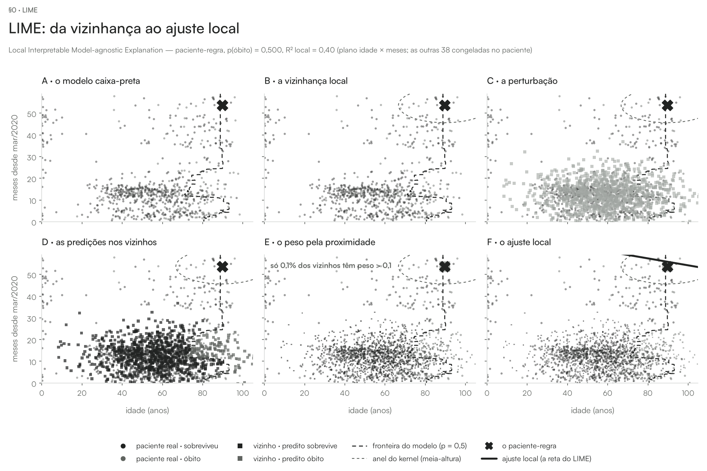
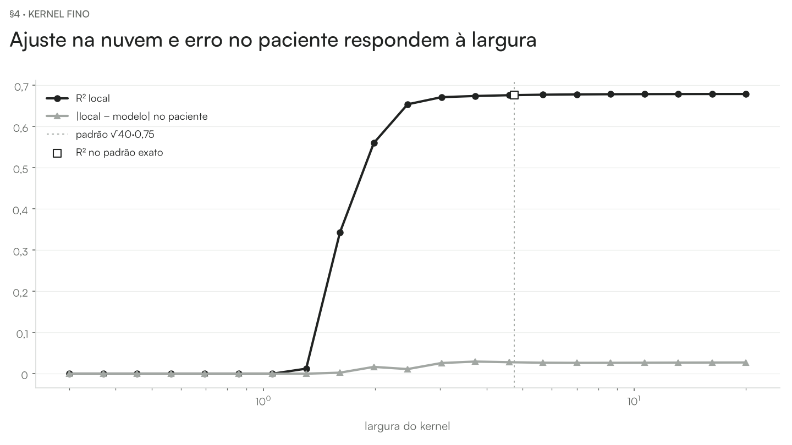

# Módulo 03 — LIME

*Autor do módulo: [William Bendinelli](https://github.com/wbendinelli) — seminário apresentado em 2026-08-24, SCC5819 (ICMC-USP, 2026), sobre a era BCW deste módulo; os decks daquela aula estão preservados em [`lecture/`](lecture/).*

LIME — *Local Interpretable Model-agnostic Explanations*, Molnar, cap. 14 —
aproxima as previsões do XGBoost SRAG/COVID em uma vizinhança ponderada.
Este módulo acompanha geração, codificação, pesos e regressão; depois confere
fidelidade, violações de regras e estabilidade nos exemplares declarados.

## Objetivos de aprendizagem

1. Identificar os termos do objetivo e acompanhar a chamada de LIME na figura A–F.
2. Separar níveis categóricos decodificáveis, domínio das entradas e regras conjuntas.
3. Comparar ajuste à nuvem ponderada, erro no exemplar e estabilidade entre sementes.
4. Interpretar coeficientes na escala e vizinhança declaradas, sem equipará-los a efeitos clínicos.

## Por que explicar este modelo

O XGBoost tem AUC de teste **0,7644** e a logística de referência,
**0,7246**, na amostra deste módulo (walkthrough, setup). Esse desempenho
agregado não explica uma previsão individual. O LIME aproxima a função
do XGBoost numa nuvem artificial, e este módulo verifica quais partes
dessa aproximação podem ser conferidas.

O setup identifica o arquivo por SHA256 e imprime tamanho, óbitos,
proporção do desfecho e anos de início em cada split. A unidade é a
notificação, sem garantia de pessoa única; o treino é subamostrado e as
partições temporais de validação e teste são preservadas. Usamos apenas
a amostra commitada. As explicações do teste observado são exploratórias.

## O que o módulo mostra

**§0 — o método inteiro numa figura.** Os seis painéis A–F da era BCW,
refeitos: o modelo caixa-preta, a vizinhança, a perturbação, as
predições, o peso, o ajuste — no plano idade × meses, que é um corte
ceteris paribus do XGBoost real (módulo 01), não um modelo de brinquedo.
A figura usa **uma chamada de LIME**: a nuvem recebida pelo preditor,
os pesos recebidos pela Ridge e os coeficientes, intercepto, predição
local e R² do objeto retornado pela biblioteca. O anel usa o kernel
instalado. As verificações do ajuste aparecem no walkthrough §0 e são
reconstruídas por equações normais independentes no internals §7.

**§1–§6 — duas rodadas e três medições**, com os dois pacientes-por-regra
(o paciente-regra, |p−0,5| mínimo; o vulnerável, mesma regra restrita ao
estado vulnerável às três cercas):

1. **Sem categóricas declaradas:** 4.999/5.000 vizinhos com códigos
   fabricados, idade sintética de −12,6 a +126,9 anos e 34,3% com doses negativas.
   O wrapper arredonda as entradas para consultar o modelo; as contagens
   tornam esse tratamento visível.
2. **Com 36 discretas declaradas:** 0 códigos categóricos fabricados na
   verificação. Ainda há violações das regras conjuntas em 30,6% dos vizinhos
   do exemplar de referência e 79,2% do vulnerável. As entradas mantidas como
   contínuas, incluindo doses, exigem domínio e integralidade próprios;
   categorias decodificáveis não validam a ficha inteira.
3. **Fidelidade:** kernel estreito produz R² 0,00 e erro 0,00 no exemplar;
   largo, R² 0,68 e erro 0,028. Um ajuste quase constante pode acertar a
   predição de origem sem descrever a resposta na vizinhança.
4. **Estabilidade:** em 10 sementes, top-5 idêntico (Jaccard 1,00) e zero
   trocas de sinal no top-8; 3 das 8 entradas do topo saem do top-10 em alguma
   semente. Com nuvens de 1.000, o mínimo volta a 0,43 (internals §5).

## O que o módulo conclui, e como isso é medido

- **Codificação e regras conjuntas são verificações distintas.** Declarar
  `categorical_features` elimina os códigos fabricados na checagem das categorias,
  mas não preserva a distribuição conjunta. A correlação meses×doses é +0,61
  no treino e −0,004 na nuvem (internals §2); as frações de 30,6%/79,2%
  pertencem às regras auditadas de formulário, calendário e coorte. Elas não
  medem toda a plausibilidade clínica das amostras.
- **Geração e ponderação têm papéis diferentes.** Com
  `sample_around_instance=False`, a proposta gaussiana usa a média do treino
  (fonte no internals §1, linhas 46–49); o kernel define os pesos locais.
  O §0 imprime centro, distância do exemplar e pesos da nuvem ajustada.
  As variantes avaliadas mudam as violações: 30,6% → 3,6% no exemplar de
  referência e 79,2% → 82,9% no vulnerável; o portão fica próximo de 70%
  nas configurações testadas (internals §3). Isso não torna uma variante
  clinicamente válida ou universalmente melhor.
- **R² e erro no exemplar medem objetos diferentes.** Na varredura de
  21 larguras, valores abaixo de ~1,3 produzem ajuste quase constante,
  com R² 0,00 e erro 0,00; na configuração padrão, R² 0,68 e erro 0,028
  (walkthrough §5; internals §4). A conclusão pertence às configurações
  examinadas, sem escolher uma explicação apenas pelo maior R².

  
- **CP e LIME são comparados como diagnóstico regional.** Em doses, a
  diferença finita muda de sinal com o passo (+0,022 em h=1; −0,015 em h=2).
  O estudo ajusta uma reta ao CP em ±1 desvio e compara `inclinação × dp`
  com o coeficiente padronizado do LIME. Há concordância nas três numéricas
  com direção identificada nesse ensaio (idade, doses, semana), inclusive
  doses (+0,0078 contra +0,0306; internals §6). Essa concordância empírica
  não é uma identidade geral: CP varia uma entrada com as demais fixas;
  LIME ajusta uma regressão multivariada numa distribuição ponderada.

**Correção de interpretação.** A redação anterior chamava categorias
“bem escritas” de fichas válidas e as violações de “pacientes impossíveis”.
Também dizia que a largura escolhia “qual mentira contar” e que variantes
“salvavam” um paciente. As medidas permanecem; seu alcance é a codificação,
os filtros e a aproximação nas configurações declaradas.

Todos os números acima são do modelo do curso adotado em 2026-09-01 (800
árvores, profundidade 4, lr 0,05 — módulo 00, SELECTION.md); a versão
anterior deste módulo os media no modelo de 400 árvores / profundidade 5,
e o paciente-regra era outro (gold_id 1269214). O deslocamento é de
condicionamento, não de falsificação; as afirmações que a medição
derrubou estão marcadas individualmente, abaixo.

### O que ficou registrado como corrigido

- **A figura A–F misturava execuções.** Seu R² vinha de uma chamada
  de LIME; a nuvem e a Ridge desenhadas vinham de um novo sorteio, com
  peso manual sem a raiz quadrada do kernel. Os valores anteriores
  de meia-altura (±16 anos × ±5,7 meses), pesos (+0,0001/+0,0003) e
  fração acima do limiar (0,1%) ficam identificados como corrigidos
  (walkthrough §0). A figura atual usa os dados e o ajuste da mesma
  explicação; internals §7 verifica esse contrato independentemente.

- **O erro no paciente subia com a gramática; agora cai.** A prosa
  (walkthrough §3) dizia que declarar as categóricas subia o R² (0,39 →
  0,62) e o erro no próprio paciente junto (0,011 → 0,083) — logo, o
  ganho era da nuvem, não do paciente. Medido, o R² sobe (0,50 → 0,65) e
  o erro **cai** (0,046 → 0,008): as duas quantidades descrevem objetos distintos,
  e não uma relação de oposição necessária; o §5 examina sua variação.
- **O quinto lugar do ranking não é mais areia com 2.000 vizinhos.** A
  prosa dizia Jaccard 0,83 no top-5, mínimo 0,43; medido (walkthrough
  §6), o top-5 é **idêntico** nas dez sementes (1,00 / 1,00). A
  instabilidade não sumiu, mudou de endereço: 3 das 8 features do topo
  somem do top-10 em alguma semente, e com nuvens de 1.000 o mínimo
  volta a 0,43 (internals §5).
- **Doses deixou de divergir na ponte CP↔LIME.** A prosa dizia que a
  ponte divergia em doses, com os dois lados fracos; medido (internals
  §6), as três numéricas com direção concordam (3/3) — doses inclusive,
  por um fio (+0,0078 contra +0,0306).
- **Quem troca de sinal com o passo é doses, não idade.** A prosa citava
  idade (−0,002 em h=5; +0,003 em h=10); medida no modelo novo, idade
  mantém o sinal (+0,00431 em h=5, +0,00462 em h=10) e quem inverte é
  doses (+0,02166 em h=1; −0,01541 em h=2). O ponto — inclinação pontual
  de escadaria não se compara com peso — sobrevive na feature ao lado.

## O que a literatura propõe fazer a respeito

Knab et al. (2025) organizam variantes que alteram a amostragem, a largura
do kernel ou a estabilidade. Essa literatura e o ataque de Slack et al.
motivam os diagnósticos, mas nenhuma dessas variantes foi avaliada nesta
aplicação. Uma adoção exigiria repetir as verificações com sua própria
vizinhança e representação.

## Aula

[`lecture/outline.md`](lecture/outline.md) — a forma viva: o que dizer, o
que apontar em cada figura e as objeções a preparar. Os decks em
[`lecture/`](lecture/) são o registro histórico do seminário da era BCW
(16:9 e 16:10) e não são retro-editados; a aula atual constrói-se do
outline.

## Notebooks

- [`notebooks/lime_walkthrough.ipynb`](notebooks/lime_walkthrough.ipynb)
  — a aula: o objetivo termo a termo, a figura A–F, as duas rodadas, as
  cercas, o kernel e as sementes. Usa a amostra commitada, sem carregar a Gold completa; a instalação das
  dependências requer rede quando o ambiente não está preparado.
- [`notebooks/lime_internals.ipynb`](notebooks/lime_internals.ipynb) — o
  companheiro técnico, que confere os cálculos e a implementação: lê a assinatura e
  as linhas do gerador no fonte instalado (a chamada privada da qual as
  contagens dependem quebraria aqui primeiro, de propósito), mede centro
  e correlações da nuvem, as variantes nos dois
  exemplares, 21 larguras de kernel, 21 sementes × 2 tamanhos de nuvem e
  a ponte CP↔LIME contra o ruído de semente e a reconstrução do ajuste
  bidimensional por equações normais (internals §7).

As figuras commitadas estão em `figures/`. Os notebooks geram novas
cópias em `figures_generated/`, dentro de uma pasta temporária externa
ao repositório. `INTERPRETABLE_ML_WORK` permite escolher essa pasta; a
promoção das figuras continua explícita. O tema é SAPIANS Global, com
preto e cinzas, formas para a origem dos pontos e traços para as linhas.
Satoshi é opcional via `SAPIANS_SATOSHI_DIR`; sem instalação explícita,
o perfil usa Inter e imprime a fonte escolhida.

## Nota de configuração

Os notebooks passam `discretize_continuous=False` (o default da lib
fraseia explicações como intervalos de quartis — a forma das figuras do
Molnar; contínuo permite desenhar a reta do §0 e expõe o gerador) e
declaram as 36 discretas em `categorical_features` na rodada codificada —
a comparação entre essas rodadas é o núcleo do módulo. Quem rodar com defaults
verá outra apresentação do mesmo algoritmo; o internals §3 mede a
variante com discretizador.

## Referências

- Ribeiro, M. T., Singh, S., & Guestrin, C. (2016). ["Why Should I Trust You?": Explaining the Predictions of Any Classifier](https://arxiv.org/abs/1602.04938). *KDD 2016*. (O artigo original do LIME.)
- Molnar, C. *Interpretable Machine Learning*, 3ª ed. — [cap. 14, LIME](https://christophm.github.io/interpretable-ml-book/lime.html). (Livro-texto do curso. Das limitações que o capítulo lista, três são medidas aqui: a definição da vizinhança, a amostragem que ignora correlação e a instabilidade entre rodadas.)
- Garreau, D., & von Luxburg, U. (2020). [Explaining the Explainer: A First Theoretical Analysis of LIME](https://proceedings.mlr.press/v108/garreau20a.html). *AISTATS 2020*. (A análise teórica do LIME tabular; a observação de que falta uma heurística fundamentada para a largura do kernel — §4 — é o problema aberto que o nosso §5 ilustra por medição.)
- Slack, D., Hilgard, S., Jia, E., Singh, S., & Lakkaraju, H. (2020). [Fooling LIME and SHAP](https://dl.acm.org/doi/10.1145/3375627.3375830). *AIES 2020*. (O custo da amostragem fora da variedade, levado à conclusão: um classificador que detecta as perturbações esconde seu viés do LIME.)
- Knab, P., Marton, S., Schlegel, U., & Bartelt, C. (2025). [Which LIME should I trust? Concepts, Challenges, and Solutions](https://arxiv.org/abs/2503.24365). *XAI 2025*. (O survey das variantes, mapeado acima; a [página companheira](https://patrick-knab.github.io/which-lime-to-trust/) acompanha variantes novas.)
- [`marcotcr/lime`](https://github.com/marcotcr/lime) — a implementação de referência, validada contra o fonte em `lime_internals.ipynb` §1.
- Base, modelo, pacientes e cercas: módulo 00 ([MODEL.md](../00-dataset/MODEL.md), [GOLD.md](../00-dataset/GOLD.md), [gold/MANIFEST.md](../00-dataset/gold/MANIFEST.md)).
