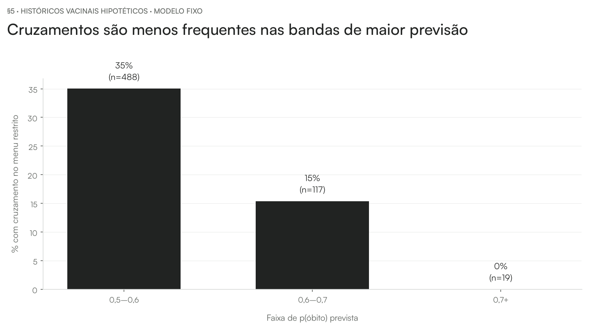

# Módulo 04 — Contrafactuais

*Autor do módulo: [William Bendinelli](https://github.com/wbendinelli) — SCC5819 (ICMC-USP, 2026). Módulo novo, criado direto sobre o caso COVID.*

Explicações contrafactuais — Dandl e Molnar, cap. 15; Wachter et al. (2018) —
sobre o [preditor retrospectivo do curso](../00-dataset/MODEL.md). A pergunta
é quais mudanças nas entradas cruzam um limiar da previsão, dentro de uma
grade declarada. O método não identifica, por si só, mudanças causais do
desfecho ou ações clínicas disponíveis.

## Objetivos de aprendizagem

Ao final, você deve conseguir:

1. Formular uma busca finita e declarar quais entradas permanecem fixas.
2. Distinguir cruzamento do limiar, proximidade, poucas alterações, restrições
   e diversidade, acompanhando o alcance de cada verificação.
3. Comparar candidatos diferentes para o mesmo preditor sem tratá-los como
   intervenções causais ou prescrições.
4. Interpretar ausência de solução como resultado do menu e limiar estudados,
   sem concluir impossibilidade clínica ou inexistência de outras alternativas.

## O caso e o protocolo

Usamos a amostra distribuída do módulo 00 e a referência histórica, sem novo
modelo ou seleção. O setup imprime n, óbitos, proporções por partição,
limites temporais e hash da amostra. A unidade é a notificação; não foi
demonstrada separação por pessoa. O teste já observado é exploratório.

O exemplar segue a regra publicada: probabilidade mais próxima de 0,8 no
teste, desempate por `gold_id`. A busca procura candidatos com p < 0,5;
esse limiar é uma convenção didática, sem validação de decisão clínica.

**Calendário fixo.** `meses_desde_mar2020` e `semana_epi` derivam da mesma
data de início dos sintomas e ficam congelados. A função de aplicação rejeita
movimentos nessas colunas. Uma grade abstrata de meses não fornece uma data
real a partir da qual recalcular a semana (walkthrough §1; internals §0–§1).

## O que o módulo mostra

| Etapa | Resultado e alcance |
|---|---|
| Menu declarado — walkthrough §1 | 103 movimentos simples; mês e semana fixos. |
| Mudanças isoladas — §2 | `saturacao → nao` reduz p de 0,793 para 0,571. Nenhuma mudança simples cruza 0,5; 1,9% violam as restrições disponíveis. |
| Pares no recorte — §3 | 1.688 pares entre os 60 melhores movimentos simples; 65 cruzam o limiar passando nas restrições. O menor p é 0,3157. |
| Conferência completa — internals §1 | 5.099 pares da grade; o menor p também é 0,3157. A igualdade é medida neste exemplar, sem garantia geral do recorte. |
| Diversidade — walkthrough §4 | A regra gulosa encontra 2 histórias disjuntas: saturação + idade (p 0,316) e imunodepressão + desconforto respiratório (p 0,452). Não é uma busca pelo máximo número de histórias. |
| Menu restrito — §5 | Mais doses anteriores ao sintoma e mudança da declaração. São históricos hipotéticos no modelo, não ações executáveis retroativamente. |
| Comparação de critérios — §6 | O candidato restrito fica em Gower 0,0042 e não cruza; o melhor par que cruza fica em 0,0297. Menor p e menor distância são objetivos distintos. |

A nuvem de p versus Gower mostra candidatos enumerados. **Não é a perda de
Wachter inteira, uma fronteira Pareto calculada ou uma enumeração do espaço
contínuo de entradas.** O módulo é uma aplicação didática inspirada nos
objetivos discutidos pelo capítulo; não executa os otimizadores de Wachter,
NSGA-II ou DiCE.

Passar em `gate_impossible` significa apenas não violar as regras implementadas
de formulário, calendário e pertencimento à coorte. Isso não certifica
plausibilidade clínica ou suporte na distribuição conjunta.

## Como interpretar o painel restrito

O menu aumenta a contagem de doses registradas antes dos sintomas e, quando
aplicável, muda a declaração de vacinação. Essas mudanças não estimam o efeito
de vacinar: um histórico prévio não pode ser administrado retroativamente a
quem já está internado. O nome histórico `candidatos_acionaveis` permanece no
código; a apresentação descreve seu alcance como **menu hipotético restrito**.

Para o exemplar, os 2 candidatos de 5 ou 6 doses mantêm p em 0,793. No painel
de 624 notificações com p original ≥ 0,5, há 189 com cruzamento (30,3%) e
435 sem cruzamento (69,7%). As frações por banda são 35%, 15% e 0%; a última
contém 19 notificações. Esses valores permanecem iguais ao registro anterior,
porque o painel já conservava o calendário (walkthrough §5).

Os internals §4 alteram o limiar de destino no mesmo painel original:
0,5 → 30,3%; 0,4 → 9,3%; 0,3 → 1,1%. Isso não demonstra ausência de
alternativa clínica, efeito de tratamento ou generalização à população.

## O que ficou registrado como corrigido

- **Calendário incompleto.** O menu anterior alterava mês e conservava semana.
  Oferecia 113 movimentos simples, 6.129 pares completos e 1.691 pares no
  recorte top-60; 68 cruzavam e passavam nas cercas antigas. O melhor p era
  0,1995, com mês 6 e zero doses, em Gower 0,0339. A busca corrigida congela
  ambas as codificações e produz os resultados da tabela acima. Os internals
  §1 recompõem o menu antigo somente para documentar essa correção.
- **Quantidade de histórias.** A regra gulosa anterior exibia 3 histórias;
  a mesma regra encontra 2 no menu corrigido. A apresentação imprime a
  quantidade encontrada e não força uma terceira história (walkthrough §4).
- **Perda e ótimo.** A redação anterior chamava a nuvem de “perda de Wachter
  vista por inteiro” e generalizava a exaustão. Agora o resultado está
  limitado à grade finita e ao recorte declarado; a conferência completa
  mede o mínimo nessa grade (internals §1).
- **Acionabilidade.** A redação anterior chamava os históricos vacinais de
  “alavancas reais” e a ausência de cruzamento de falta de saída ao alcance.
  O menu é um contraste de entradas; não identifica recourse clínico ou
  efeito causal. O capítulo já discute entradas sob controle do sujeito;
  esse tema não é uma contribuição inédita deste módulo.

Registro anterior: adoção da referência histórica

Os números e a palavra “acionável” no registro abaixo pertencem à redação da
etapa anterior. As correções acima delimitam o calendário e a interpretação
vigentes; os valores antigos ficam preservados como memória.

A barra de evidência (regra 3) manda o valor antigo ficar no registro
quando a medição derruba a prosa. As deste re-sync:

- **A busca livre não pede mais "rejuvenesça 71 anos".** A prosa dizia
  que a melhor mudança única era `idade → 10` no paciente de 81 anos
  (p 0,804 → 0,480); a regra "p ≈ 0,8" agora cai num paciente de 32 anos
  e a melhor mudança única é `saturacao → nao` (walkthrough §2,
  p 0,793 → 0,571). A lição — a menor mudança é algo que ninguém pode
  fazer — sobreviveu; o exemplo mudou de figura.
- **Nenhuma mudança única cruza mais o limiar.** Antes havia 1; mede 0
  (walkthrough §2). A busca só encontra contrafactual válido em
  profundidade 2.
- **O gradiente por banda é mais duro do que a prosa dizia.** Dizia
  43% → 25% → 3%; mede 35% → 15% → **0%** (walkthrough §5). Na banda de
  maior risco não é "quase ninguém": é ninguém — 19 pacientes, nenhuma
  saída. O "97% na banda de maior risco" desta página vira 100%.
- **As frações de cobertura caíram.** 36% com contrafactual acionável e
  64% sem, sobre 902 pacientes, medem agora 30,3% e 69,7% sobre 624
  (walkthrough §5); por limiar, 0,4 → 16,2% mede 9,3%, e 0,3 → 2,5% mede
  1,1% (internals §4).
- **O Rashomon é outro, e menor.** A prosa dizia 151 candidatos válidos
  e três histórias com p → 0,18 / 0,34 / 0,40 (criança sem
  imunodepressão; saturação + raça; gestante de idade ignorada aos 81);
  medido (walkthrough §4), são 68 candidatos válidos e as três histórias
  disjuntas são outras — mês 6 com zero doses (0,199), saturação apagada
  + 10 anos (0,316), imunodepressão e desconforto respiratório curados
  (0,452).
- **Subir doses não aumenta mais a p deste paciente.** A prosa dizia que
  aumentava (0,829); mede 0,793 → 0,793 — não cruza e não move a
  previsão na terceira casa (walkthrough §5). O que continua de pé é a
  resposta "não há contrafactual acionável para ele".
- **O contrafactual mais eficaz está oito vezes mais longe, não dez.**
  Gower 0,0400 → **0,0339**, contra os 0,0042 do acionável, que não se
  moveu (walkthrough §6).

## Aula e notebooks

- [Outline da aula](lecture/outline.md): sequência de leitura e perguntas de discussão.
- [Walkthrough](notebooks/cf_walkthrough.ipynb): síntese da base, menu fixo,
  mudanças isoladas, pares, diversidade e históricos hipotéticos restritos.
- [Internals](notebooks/cf_internals.ipynb): guardas do calendário, grade
  completa, auditoria do menu anterior, restrições e sensibilidade do limiar.

Os cadernos escrevem figuras em `figures_generated/` dentro de um diretório
temporário externo. `INTERPRETABLE_ML_WORK` permite indicar esse diretório;
a promoção para `figures/` é explícita, após execução e inspeção.

## Figuras e identidade visual

As figuras usam `SP.aplicar(tema="global")`: preto e cinzas, sem depender de
cor para distinguir candidatos que passam ou violam restrições. As formas
e os rótulos identificam as séries. O tema usa a fonte empacotada de fallback
ou uma instalação local explícita de Satoshi, conforme
[a configuração das fontes](../../tools/fonts/README.md).

## Referências

- Dandl, S.; Molnar, C. *Interpretable Machine Learning*, 3ª ed. — [cap. 15 (Counterfactual Explanations)](https://christophm.github.io/interpretable-ml-book/counterfactual.html).
- Wachter, S.; Mittelstadt, B.; Russell, C. (2018). [Counterfactual Explanations without Opening the Black Box](https://arxiv.org/abs/1711.00399). *Harvard JOLT 31(2)*. Formulação da perda; esta aplicação não executa seu otimizador.
- Dandl, S.; Molnar, C.; Binder, M.; Bischl, B. (2020). [Multi-Objective Counterfactual Explanations](https://arxiv.org/abs/2004.11165). NSGA-II com objetivos de saída, distância, esparsidade e plausibilidade.
- Mothilal, R. K.; Sharma, A.; Tan, C. (2020). [Explaining Machine Learning Classifiers through Diverse Counterfactual Explanations](https://doi.org/10.1145/3351095.3372850) (DiCE). Alternativa citada, não executada neste módulo.
- [Contrato Gold](../00-dataset/gold/MANIFEST.md) · [Modelo histórico](../00-dataset/MODEL.md) · [Codificação temporal](../../tools/srag_40_gold.py).
