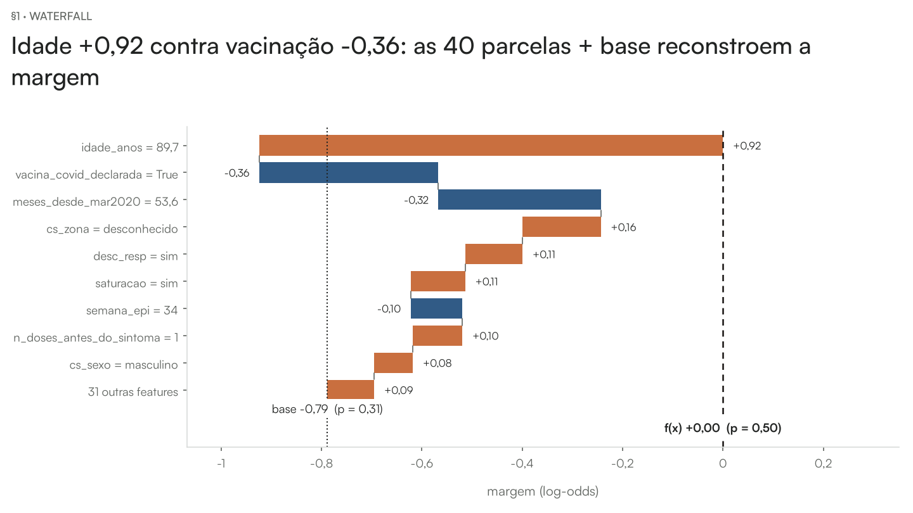

# Módulo 05 — SHAP

*William Bendinelli · SCC5819 (ICMC-USP, 2026).*

Molnar, capítulos 17–18: repartir uma predição entre os valores das entradas,
sob um jogo de ausência declarado. O estudo usa a amostra Gold e o XGBoost
histórico do [módulo 00](../00-dataset/README.md). As contribuições nativas de
`pred_contribs` estão na **margem**, em log-odds. Waterfall, force, beeswarm,
importância média e dependence são construídos a partir desses valores.

## Objetivos de aprendizagem

- Definir o jogo de coalizões e verificar a soma na escala explicada.
- Ler os gráficos sem confundir atribuição, substituição de entrada e causa.
- Distinguir o jogo de caminhos do estimador marginal por permutação.
- Investigar interações com seu conjunto e sua medida explícitos.

## Por que encerrar a sequência local com SHAP

Este módulo encerra a sequência dos métodos locais, antes dos estudos globais.
O cálculo de caminhos é determinístico com fit e entradas fixos; sua soma
reconstrói a margem. Essa propriedade não resolve a escolha do jogo, a
representatividade do conjunto ou a viabilidade das combinações avaliadas.

O walkthrough imprime a identidade da amostra, partições, desfechos e escala.
O internals verifica somas, refits, valor base e interações. Essas verificações
não demonstram utilidade clínica na admissão.

## O que o módulo mostra

| Seção do walkthrough | Objeto e leitura |
|---|---|
| §1 · Waterfall | Base e contribuições até a margem do exemplar. O internals §2 compara a base com médias empíricas; são objetos distintos. |
| §2 · Force | As mesmas contribuições ordenadas em uma linha. |
| §3 · SHAP × LIME | Mesmo exemplar, jogos e escalas próprios. Concordância de sinais é descritiva; não é requisito de correção. |
| §4 · Global | Média absoluta e distribuição das contribuições no teste histórico. Diferenças em relação a gain não isolam deriva temporal. |
| §5 · Dependence | Atribuições na amostra inteira, incluindo treino. A cor ajuda a investigar o calendário; dispersão visual não prova interação funcional. |
| §6 · Caminho × marginal | Estimador por permutação no espaço da margem, com fundo e orçamento declarados. |
| §7 · Restrições | Combinações produzidas pelo estimador e violações das regras do contrato. |

## O que o módulo conclui, e como isso é medido

- **Eficiência no fit declarado.** Base e contribuições reproduzem a margem;
  a sigmoide é aplicada depois da soma. Walkthrough, setup e §1 e internals §1
  imprimem os desvios e a repetição dos ajustes.
- **O jogo faz parte da resposta.** A aproximação por caminhos usa estatísticas
  das árvores e não é uma expectativa condicional exata da distribuição.
  O estimador marginal usa registros de fundo e amostragem de permutações.
  Seus resultados podem diferir; aumentar o orçamento não muda o jogo escolhido
  (walkthrough §6; internals §2 e §4).
- **Interação precisa de escopo.** O internals §3 repete as posições sorteadas
  para o dependence plot, confere simetria e somas e ordena pares pela média
  absoluta da célula fora da diagonal. Esse ranking pertence ao conjunto e ao
  jogo declarados; não é o H do [módulo 08](../08-feature-interaction/README.md).
- **Dispersão não basta.** Um controle analítico com função aditiva e entradas
  dependentes produz atribuições condicionais dispersas. É um contraexemplo
  à inferência visual geral, não uma reprodução do algoritmo de caminhos
  nem uma explicação do mecanismo presente nos dados SRAG (internals §3).
- **Atribuição não é efeito da vacinação.** O sinal de φ e as proporções
  observadas por doses e idade não removem confundimento, calendário ou
  seleção. O walkthrough §5 apresenta contagens e intervalos de idade explícitos.

### Correções preservadas

- O posto de `meses` por gain foi descrito como 16º; o ajuste histórico mede
  19º (walkthrough §4).
- O texto dizia que dispersão vertical “é a interação”, com o parceiro
  identificado pela cor. Agora separa inspeção visual e cálculo no mesmo recorte.
  A auditoria anterior usava as primeiras 2.000 linhas do teste; a atual usa
  o mesmo sorteio de 3.000 posições da amostra inteira mostrado no painel.
- O φ positivo de doses era atribuído à priorização por risco, e a tabela de
  desfechos era apresentada como resolução da questão causal. Esses mecanismos
  não foram identificados. Os intervalos de idade também foram explicitados
  para corresponder aos rótulos de anos completos (walkthrough §5).
- A divergência entre SHAP e LIME era tratada como prova de ruído. A comparação
  entre objetos diferentes não sustenta essa conclusão (walkthrough §3).

A versão anterior à adoção da referência histórica usava outro ajuste e outro
exemplar. As medições dessa etapa permanecem no histórico Git; não são resultados
intercambiáveis com os cadernos atuais.

## Aula

[Outline](lecture/outline.md): sequência, figuras e limites de interpretação.
Este módulo não tem deck histórico entregue.

## Notebooks

1. [Walkthrough](notebooks/shap_walkthrough.ipynb): aula, síntese dos dados,
   gráficos, comparação com LIME e auditoria das combinações.
2. [Internals](notebooks/shap_internals.ipynb): somas, valor base, interações
   no mesmo recorte e controle analítico, além do estimador por permutação.

Os dados distribuídos bastam para os ajustes. A instalação inicial e a abertura
via Colab podem exigir rede. As figuras usam o [perfil Global/VITA](../../tools/README.md#perfil-global-sapians--vita),
com cores de sinal preservadas e escalas próprias nas comparações. São geradas
fora do repositório, em `figures_generated/` dentro de `INTERPRETABLE_ML_WORK`
ou de uma pasta temporária. As cópias publicadas são promovidas para `figures/`.

## Nota de configuração

O estudo usa `pred_contribs` e `pred_interactions` do XGBoost, com cálculo
exato para o jogo de caminhos na margem. O estimador marginal é implementado
no caderno; não se apresenta como KernelSHAP nem como chamada à biblioteca
`shap`. As versões permanecem as de `requirements.lock`.

## Referências

- Shapley, L. S. (1953). *A Value for n-Person Games.* (O teorema da
  partilha justa que tudo aqui instancia.)
- Lundberg, S.; Lee, S.-I. (2017). [A Unified Approach to Interpreting Model Predictions](https://arxiv.org/abs/1705.07874). *NeurIPS 2017*. (SHAP: o jogo-da-predição e a unificação com LIME.)
- Lundberg, S. et al. (2020). [From local explanations to global understanding with explainable AI for trees](https://doi.org/10.1038/s42256-019-0138-9). *Nature Machine Intelligence 2*. (TreeSHAP — o algoritmo do `pred_contribs`; a fonte dos gráficos globais que o §4 reconstrói.)
- Štrumbelj, E.; Kononenko, I. (2014). *Explaining Prediction Models and Individual Predictions with Feature Contributions.* Knowledge and Information Systems 41(3). (O estimador por amostragem de permutações que o §6 implementa.)
- Molnar, C. *Interpretable Machine Learning*, 3ª ed. — caps. [17 (Shapley Values)](https://christophm.github.io/interpretable-ml-book/shapley.html) e [18 (SHAP)](https://christophm.github.io/interpretable-ml-book/shap.html). (Livro-texto: os axiomas, a interpretação correta e as leituras erradas, os gráficos, e as limitações que este módulo conta.)
- Base, modelo, pacientes e cercas: módulo 00 ([MODEL.md](../00-dataset/MODEL.md), [gold/MANIFEST.md](../00-dataset/gold/MANIFEST.md)).
