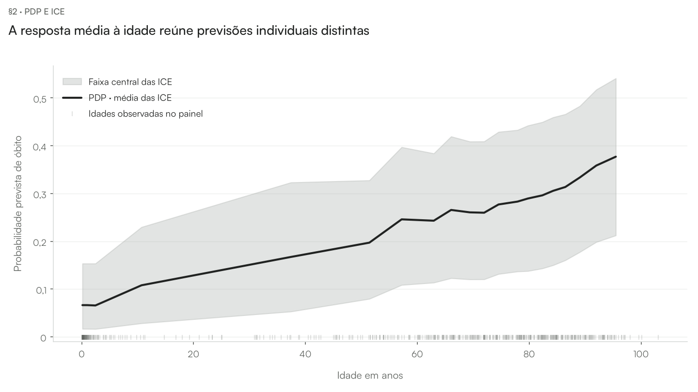
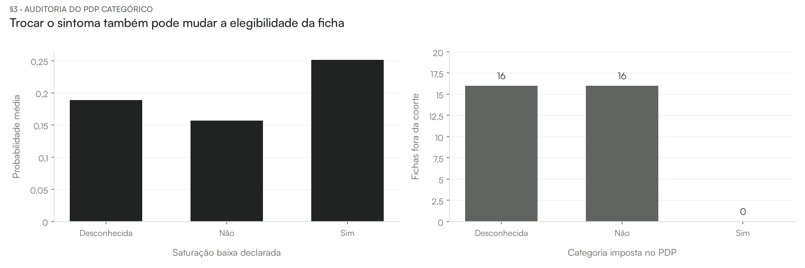
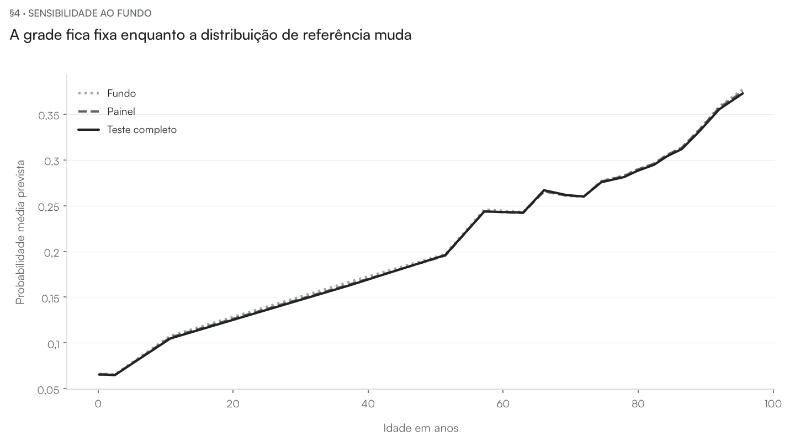

# Aula — Partial Dependence Plot (PDP)

[README](../README.md) · [walkthrough](../notebooks/pdp_walkthrough.ipynb) · [internals](../notebooks/pdp_internals.ipynb)

**Pergunta da aula.** Depois das atribuições locais do SHAP, retomamos as curvas ICE para perguntar como o preditor responde, em média, ao valor de uma entrada. Este é o estudo do capítulo 19 de Molnar sobre a mesma amostra SRAG/COVID e o mesmo XGBoost da série.

## Abrir com a operação

Partir de ICE e ler a fórmula: a mesma entrada é imposta a todas as fichas; o restante da distribuição fica no fundo. Explicar que média de previsões não é letalidade observada.

**Abrir:** walkthrough §1–§2.

## Mostrar a cerca

Ler as categorias como estados do formulário. Apontar as fichas que deixam de satisfazer os critérios SRAG e lembrar que o código conserva essas linhas para mostrar o estimando marginal.

**Abrir:** walkthrough §3.

## Discutir o fundo e a heterogeneidade

Comparar fundos sobre a mesma grade. Abrir o controle de produto quando surgir a pergunta se uma curva plana implica irrelevância.

**Abrir:** walkthrough §4; internals §2–§3.

## Conferir o parecer e seus limites

Abrir a síntese da base no walkthrough §5 e a auditoria do algoritmo no internals §4. Distinguir a definição do capítulo, a configuração adotada e o alcance das conclusões. O [parecer no README](../README.md#auditoria-frente-ao-livro-e-ao-código) registra adaptações e achados; a concordância de cálculo não certifica validade clínica.

## Perguntas para discussão

- Que distribuição foi usada como referência e que população ela representa?
- O que permaneceu fixo e quais combinações foram fabricadas?
- Como distinguir um cálculo correto de uma interpretação válida do domínio?

## Fechamento

Retomar a pergunta e as condições do estimando. A evidência é sobre a função preditiva e o protocolo declarados; efeitos clínicos exigem outro desenho de estudo. Seguir para [ALE](../../07-ale/README.md).

As medições e seus condicionamentos estão no [README](../README.md) e nas seções de caderno indicadas. Este roteiro é o material vivo da aula; não foi produzido nem alterado um deck entregue.
