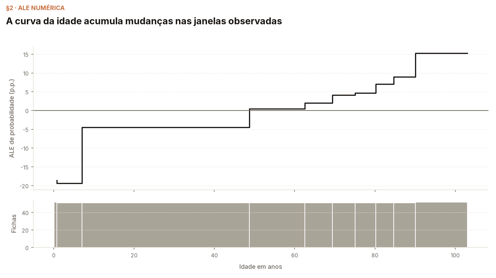

# Módulo 07 — Accumulated Local Effects (ALE)

*Autor: [William Bendinelli](https://github.com/wbendinelli) — SCC5819 (ICMC-USP). Material de estudo em português.*

O PDP impõe um valor em todo o fundo. O capítulo 20 de Molnar troca essa operação por diferenças em janelas ocupadas pela entrada. Aplicamos ALE numérica à idade no mesmo XGBoost SRAG/COVID, com as hipóteses de discretização à vista.

## Objetivos de aprendizagem

1. Calcular diferenças nas bordas das janelas de idade.
2. Acumular médias locais e centralizar por contagens.
3. Comparar ALE com um PDP centralizado sem equiparar seus estimandos.
4. Conferir empates, entrada constante, intervalos vazios e sensibilidade da discretização.

## Por que explicar este modelo

O [módulo da base](../00-dataset/MODEL.md) estabelece o contrato SRAG/COVID e a receita histórica do XGBoost. O modelo é reconstruído sobre **200.000 registros de treino**, com treino até **2022**, validação em **2023** e teste em **2024**. O teste contém **16.142 registros**, com **2.945 óbitos**; o log loss reconstruído é **0,409020** (walkthrough §1).

O painel de explicação sorteia **512 fichas** do teste, após ordenar por `gold_id`, com semente **42**; suas primeiras **256 fichas** formam o fundo compartilhado. O alvo não orienta o sorteio. As análises do teste já observado são exploratórias. Não há nova seleção de modelo ou de intervenções clínicas (walkthrough §1).

## O que o módulo mostra

- **§1:** Dados, escala e amostras de explicação.
- **§2:** Tabela das diferenças locais e curva ALE centralizada.
- **§3:** Comparação com PDP nas mesmas bordas.
- **§4:** Sensibilidade ao orçamento de intervalos.

**O caso.** O mesmo preditor da série e a amostra Gold commitada. As perturbações são avaliações artificiais da função, não novos registros observados. A saída explicada é a probabilidade de óbito. A seleção hospitalar, as restrições do formulário e a dependência entre entradas limitam a leitura.

## O que o módulo conclui, e como isso é medido

- **A média usa os pesos das fichas.** A centralização é conferida sobre o efeito atribuído a cada registro, e a reconstrução independente coincide com o núcleo (walkthrough §2; internals §2).

- **ALE e PDP não são a mesma curva.** Nas bordas e na centralização declaradas, a maior diferença é **0,7799 p.p.** (walkthrough §3). A distância não identifica qual estimando seria um efeito causal.

- **A resolução depende do suporte.** Com **5, 10 e 20 intervalos**, a menor contagem local é, respectivamente, **102, 51 e 25 fichas**; as amplitudes são impressas junto da configuração (walkthrough §4).

- **Associação não é sensibilidade à entrada.** No controle em que o preditor ignora a entrada estudada, ALE tem amplitude **0,000000**, embora a média condicional varie; o internals também verifica entrada constante, empates e rejeição de intervalos vazios (internals §2–§3).

## Aula

- [Roteiro da aula](lecture/outline.md): leitura das figuras, perguntas e limites.
- Próximo estudo na sequência do livro: [Interação](../08-feature-interaction/README.md).

## Cadernos

- [Walkthrough](notebooks/ale_walkthrough.ipynb): aplicação e figuras com resultados impressos.
- [Internals](notebooks/ale_internals.ipynb): cálculos independentes, controles e condições de validade.

As figuras publicadas em `figures/` são cópias explícitas das saídas do walkthrough e do internals. Cada execução escreve os novos arquivos em `figures_generated/` dentro de uma pasta temporária externa ao repositório; os caminhos de trabalho não são gravados nas saídas.

## Configuração e limites

A curva principal usa **10 intervalos por quantis**, unindo bordas repetidas. A convenção discreta é a do acúmulo na borda superior: cada ficha recebe o degrau de seu intervalo. A média ponderada por contagens centraliza os degraus, sem interpolação. Ausências, entradas não numéricas e intervalos vazios são recusados. Este módulo não ordena categorias nominais nem implementa ALE de interação. Janelas locais reduzem o afastamento da entrada estudada, mas não garantem fichas clinicamente plausíveis.

Os núcleos estão em [srag_71_global_effects.py](../../tools/srag_71_global_effects.py), e o walkthrough mostra o código executado. Não adicionamos dependências: a aplicação usa a pilha fixada em [requirements.lock](../../requirements.lock). A referência histórica permanece a mesma adotada pela PFI; adotar outro preditor exige recalcular os resultados.

## Referências

- Molnar, C. *Interpretable Machine Learning* — [cap. 20: Accumulated Local Effects (ALE)](https://christophm.github.io/interpretable-ml-book/ale.html). (Mecanismo e limites da interpretação.)
- Apley, D. W.; Zhu, J. (2020). [Visualizing the Effects of Predictor Variables in Black Box Supervised Learning Models](https://doi.org/10.1111/rssb.12377). (Efeitos locais acumulados e suas condições.)
