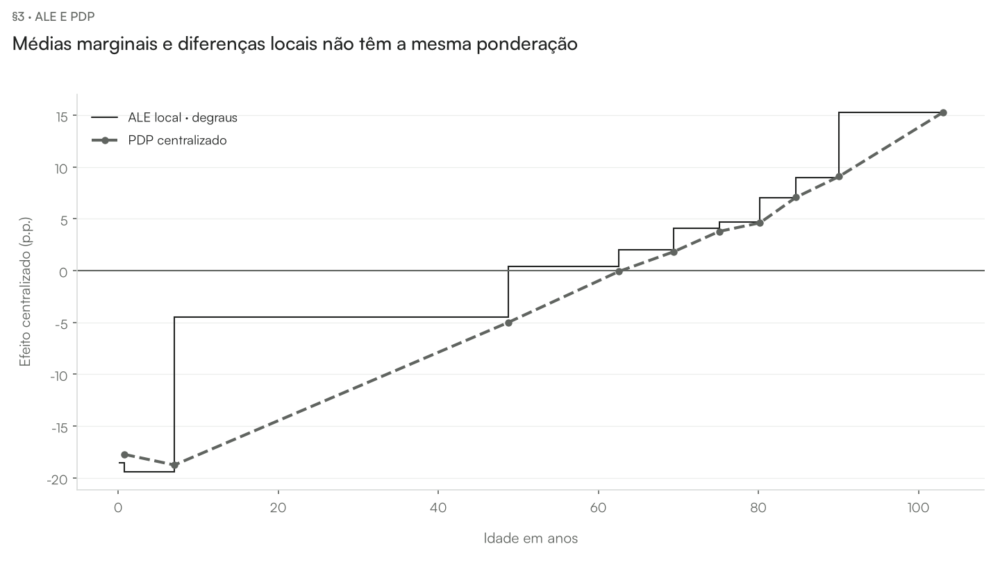
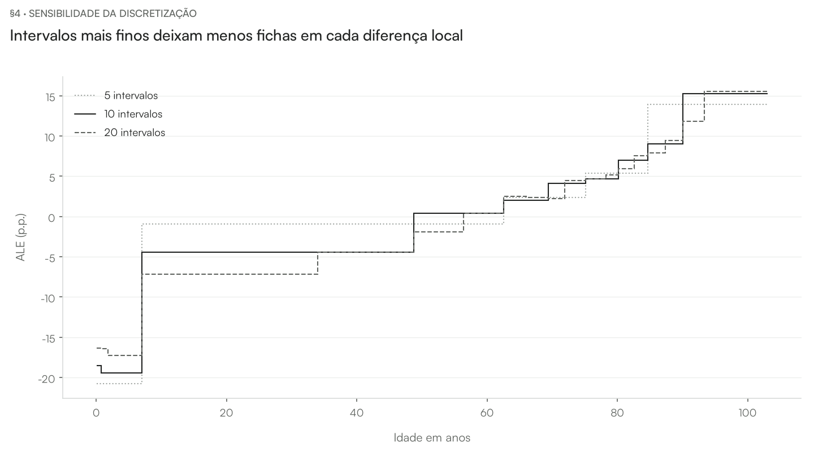

# Aula — Accumulated Local Effects (ALE)

[README](../README.md) · [walkthrough](../notebooks/ale_walkthrough.ipynb) · [internals](../notebooks/ale_internals.ipynb)

**Pergunta da aula.** O PDP impõe um valor em todo o fundo. O capítulo 20 de Molnar troca essa operação por diferenças em janelas ocupadas pela entrada. Aplicamos ALE numérica à idade no mesmo XGBoost SRAG/COVID, com as hipóteses de discretização à vista.

## Mostrar as diferenças antes da curva

Ler a tabela de bordas, contagens e diferenças. Acumular uma sequência na tela e identificar a constante retirada para centralizar.

**Abrir:** walkthrough §1–§2.

## Comparar perguntas

As curvas estão centralizadas de forma comparável para visualização. Explicar por que média marginal e diferença local não se tornam o mesmo estimando por centralização.

**Abrir:** walkthrough §3.

## Variar a resolução

Ler a menor contagem junto da amplitude. Usar o controle dependente para distinguir média condicional de efeito da entrada sobre o preditor.

**Abrir:** walkthrough §4; internals §2–§3.

## Conferir o parecer e seus limites

Abrir a síntese da base no walkthrough §5 e a auditoria do algoritmo no internals §4. Distinguir a definição do capítulo, a configuração adotada e o alcance das conclusões. O [parecer no README](../README.md#auditoria-frente-ao-livro-e-ao-código) registra adaptações e achados; a concordância de cálculo não certifica validade clínica.

## Perguntas para discussão

- Que distribuição foi usada como referência e que população ela representa?
- O que permaneceu fixo e quais combinações foram fabricadas?
- Como distinguir um cálculo correto de uma interpretação válida do domínio?

## Fechamento

Retomar a pergunta e as condições do estimando. A evidência é sobre a função preditiva e o protocolo declarados; efeitos clínicos exigem outro desenho de estudo. Seguir para [Interação](../../08-feature-interaction/README.md).

As medições e seus condicionamentos estão no [README](../README.md) e nas seções de caderno indicadas. Este roteiro é o material vivo da aula; não foi produzido nem alterado um deck entregue.
