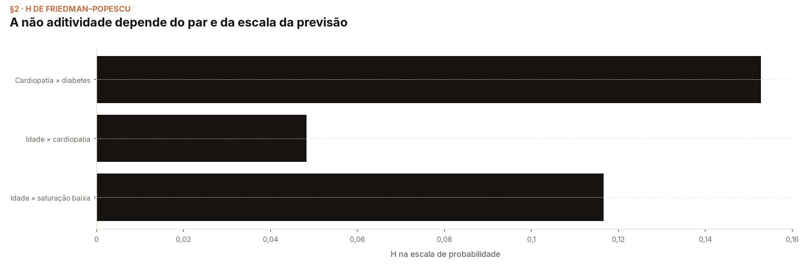
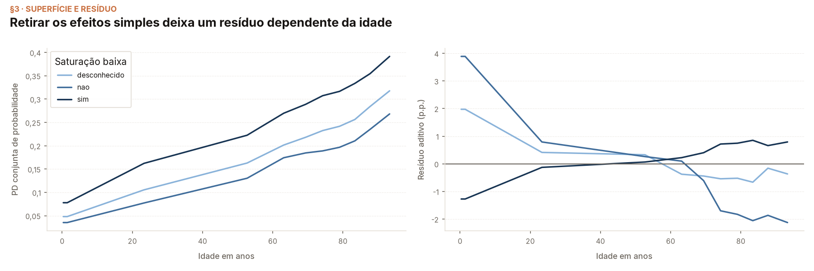
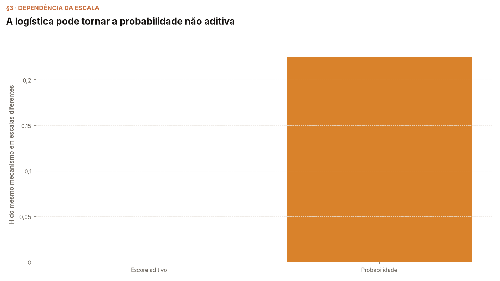

# Aula — Feature Interaction

[README](../README.md) · [walkthrough](../notebooks/interaction_walkthrough.ipynb) · [internals](../notebooks/interaction_internals.ipynb)

**Pergunta da aula.** Depois dos efeitos principais, o capítulo 21 de Molnar pergunta onde a resposta do modelo deixa de ser aditiva. Calculamos a estatística H de Friedman–Popescu em pares declarados do mesmo caso SRAG/COVID e examinamos o resíduo, o denominador e a escala.

## Definir aditividade antes da razão

Escrever a soma de dependências parciais e o resíduo. Conferir que os termos são centralizados nos mesmos pontos observados.

**Abrir:** walkthrough §1–§2.

## Ler o mapa do resíduo

Comparar a superfície conjunta e a resposta após retirar os efeitos simples. Distinguir magnitude em pontos percentuais e normalização pelo denominador.

**Abrir:** walkthrough §3.

## Questionar estabilidade e escala

Ler a sensibilidade ao fundo. Abrir os controles conhecidos e a logística de um escore aditivo; concluir que H exige informar a escala e não mede importância.

**Abrir:** walkthrough §4; internals §2–§3.

## Perguntas para discussão

- Que distribuição foi usada como referência e que população ela representa?
- O que permaneceu fixo e quais combinações foram fabricadas?
- Como distinguir um cálculo correto de uma interpretação válida do domínio?

## Fechamento

Retomar a pergunta e as condições do estimando. A evidência é sobre a função preditiva e o protocolo declarados; efeitos clínicos exigem outro desenho de estudo. Seguir para [Decomposição funcional](../../09-functional-decomposition/README.md).

As medições e seus condicionamentos estão no [README](../README.md) e nas seções de caderno indicadas. Este roteiro é o material vivo da aula; não foi produzido nem alterado um deck entregue.
