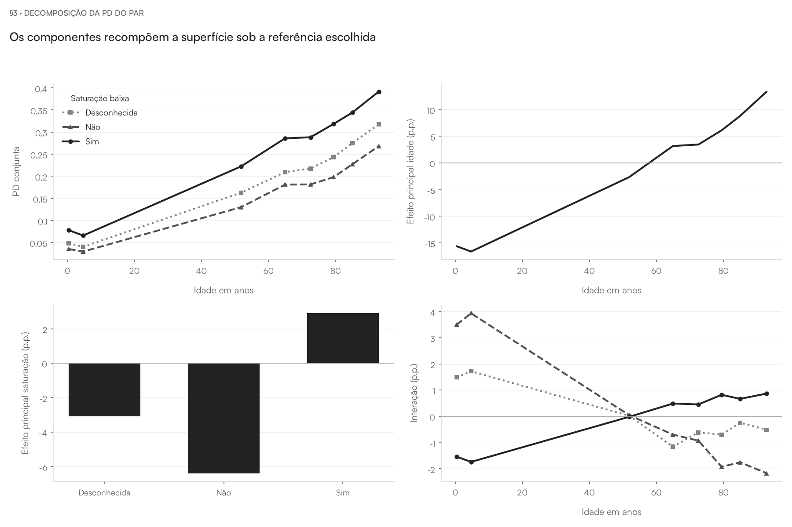
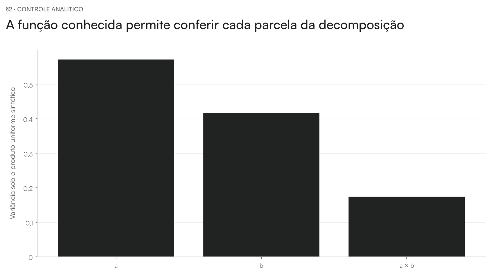

# Aula — Functional Decomposition

[README](../README.md) · [walkthrough](../notebooks/decomposition_walkthrough.ipynb) · [internals](../notebooks/decomposition_internals.ipynb)

**Pergunta da aula.** No capítulo 22 de Molnar, decompor uma função exige regras que identifiquem seus componentes. Aplicamos ANOVA funcional à superfície de dependência parcial idade × saturação do XGBoost SRAG/COVID, sob pesos produto explícitos. O objeto decomposto é essa superfície marginalizada e discretizada, não o preditor inteiro.

## Declarar o objeto

A função da aula é a dependência parcial do par, com as demais entradas integradas sobre o fundo. Declarar a medida produto e o que a reconstrução verifica.

**Abrir:** walkthrough §1–§2.

## Ler os componentes

Somar intercepto, efeitos principais e resíduo no mesmo ponto da grade. A identidade de variâncias exige a ortogonalidade sob a medida declarada.

**Abrir:** walkthrough §2–§3; internals §3.

## Trocar a referência

Mostrar que a superfície fica fixa e seus componentes mudam. Ler a comparação da conjunta observada com o produto; fechar com a passagem para PFI, que mede erro após perturbação.

**Abrir:** walkthrough §4; internals §2–§3.

Usar a tabela de componentes sob os pesos alternativos no walkthrough §4.
A figura da seção anterior mostra a referência original; não compara as
duas medidas.

## Conferir em funções conhecidas

O controle sintético verifica a separação entre efeitos aditivos e interação
com funções cujo resultado é conhecido. Ele não representa uma troca de
pesos na superfície SRAG.

**Abrir:** internals §2.

## Conferir o parecer e seus limites

Abrir a síntese da base no walkthrough §5 e a auditoria do algoritmo no internals §4. Distinguir a definição do capítulo, a configuração adotada e o alcance das conclusões. O [parecer no README](../README.md#auditoria-frente-ao-livro-e-ao-código) registra adaptações e achados; a concordância de cálculo não certifica validade clínica.

## Perguntas para discussão

- Que distribuição foi usada como referência e que população ela representa?
- O que permaneceu fixo e quais combinações foram fabricadas?
- Como distinguir um cálculo correto de uma interpretação válida do domínio?

## Fechamento

Retomar a pergunta e as condições do estimando. A evidência é sobre a função preditiva e o protocolo declarados; efeitos clínicos exigem outro desenho de estudo. Seguir para [PFI](../../10-pfi/README.md).

As medições e seus condicionamentos estão no [README](../README.md) e nas seções de caderno indicadas. Este roteiro é o material vivo da aula; não foi produzido nem alterado um deck entregue.
