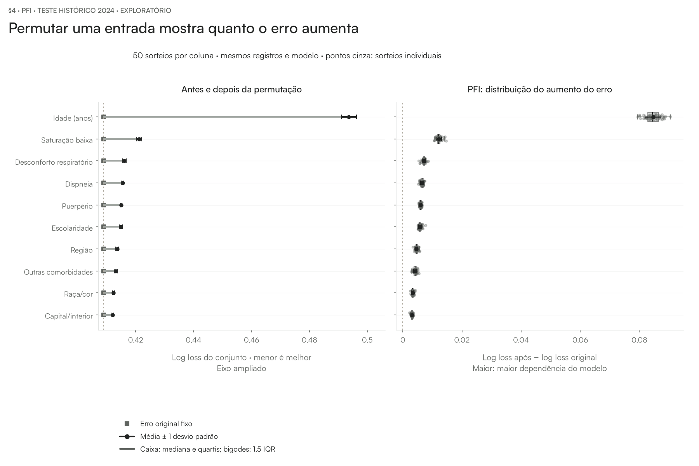

# Módulo 10 — Permutation Feature Importance

[](https://colab.research.google.com/github/wbendinelli/interpretable-ml-lectures/blob/main/modules/10-pfi/notebooks/pfi_walkthrough.ipynb)
[](https://colab.research.google.com/github/wbendinelli/interpretable-ml-lectures/blob/main/modules/10-pfi/notebooks/pfi_internals.ipynb)

*Autor do módulo: [William Bendinelli](https://github.com/wbendinelli) — SCC5819 (ICMC-USP). Material de estudo em português; apresentação interativa em inglês.*

**Permutation Feature Importance (PFI)** — Molnar, capítulo 23 — pergunta
**quanto o erro de um modelo fixo muda quando embaralhamos uma entrada**.
Depois de estudar a forma das previsões, passamos à dependência do desempenho,
com métrica, registros avaliados e procedimento de permutação declarados.

## Aula

| Abrir | Para quê |
|---|---|
| [Apresentação interativa](lecture/pfi-interactive/index.html) | Sequência da aula em inglês, com o experimento e seus resultados. |
| [Guia do professor](lecture/pfi-interactive/teacher-guide.html) | Preparar a fala em português e conferir a leitura de cada tela. |
| [Roteiro vivo](lecture/outline.md) | Consultar o texto editável e os limites de cada conclusão. |

<details>
<summary>Abrir a apresentação e exportar uma cópia independente</summary>

Sirva a raiz do repositório por HTTP:

```bash
python3 -m http.server 8765 --bind 127.0.0.1
```

Abra `http://127.0.0.1:8765/modules/10-pfi/lecture/pfi-interactive/index.html`.
Avance pelas setas ou pelo seletor inferior. Os hashes das telas são rotas de
JavaScript. As fontes são compartilhadas pelo repositório; o
[exportador documentado](../../tools/README.md#a-sequência) produz um pacote
independente. O caminho antigo no módulo 00 redireciona para a versão atual.

</details>

## Cadernos

### Referência usada na aula

- [pfi_walkthrough.ipynb](notebooks/pfi_walkthrough.ipynb): reconstrói o preditor,
  acompanha a permutação, produz figuras e imprime os resultados citados aqui.
- [pfi_internals.ipynb](notebooks/pfi_internals.ipynb): confere fórmulas e transporte
  com oráculo independente, incluindo categorias, matriz original, pares e grupos.

As execuções escrevem em `figures_generated/` numa área temporária externa.
As cópias de `figures/` são promovidas explicitamente. Execute cada caderno
por inteiro, com kernel novo, antes de salvar seus outputs.



## Objetivos de aprendizagem

1. Permutar a entrada e medir o erro sem retreino, restaurando a matriz a cada rodada.
2. Ler log loss, diferença, razão e ranking, distinguindo um sorteio da média.
3. Delimitar o SD entre embaralhamentos e sua diferença para incerteza populacional.
4. Distinguir operações marginais, conjuntas e dentro de subgrupos.

## Por que explicar este modelo

A aula explica a [referência histórica XGBoost](../00-dataset/MODEL.md) sobre
a coorte hospitalizada COVID do [módulo 00](../00-dataset/README.md). O contrato,
o alvo e a amostra estão no [manifesto Gold](../00-dataset/gold/MANIFEST.md).
Treino até 2022, validação em 2023 e teste histórico em 2024 permanecem separados.
O teste contém **16.142 registros**, incluindo **2.945 óbitos**, com log loss
original **0,4090** (walkthrough §1–§2). Como esse período já foi observado,
a explicação é exploratória.

As [comparações concluídas de balanceamento e famílias](../00-dataset/COURSE_STUDY.md)
conservaram o XGBoost como melhor candidato declarado por log loss de validação,
sem substituir o ajuste explicado nesta aula. A tentativa no treino completo
foi interrompida. O registro e o [walkthrough de famílias](../00-dataset/notebooks/srag_sample_family_walkthrough.ipynb)
separam esses estudos da seleção histórica por AUC.

## O que o módulo mostra

| Etapa | Onde estudar |
|---|---|
| Identificar o preditor e ler o erro de probabilidades | Walkthrough §1–§2. |
| Acompanhar uma permutação global e a janela de fichas | Walkthrough §3. |
| Comparar erro original, repetições, diferença, razão e ranking | Walkthrough §4–§5. |
| Entender o exemplo final de idade e cardiopatia | Internals §8–§9; walkthrough §9. |
| Conferir sensibilidade à métrica | Walkthrough §8. |
| Consultar o experimento anterior com pares e subgrupos | Walkthrough §6; estudos complementares abaixo. |
| Relacionar a interpretação a Molnar | Walkthrough §7. |

A média global usa **50 permutações por entrada**, com semente **42**.
A animação acompanha **oito fichas receptoras reais** da primeira permutação;
os doadores vêm do teste inteiro. As fichas são os primeiros registros adultos
de cada desfecho, sem escolha pelas previsões. Seus erros individuais ilustram
a operação; o ranking usa a avaliação global (walkthrough §3).

Valores originais pertencem a registros reais; as fichas permutadas são
combinações artificiais. Outras entradas e desfechos ficam nos destinos.
Idade conserva os anos decimais, e Unknown permanece uma categoria explícita.

### Exemplo final da aula: idade em faixas e cardiopatia

A [visualização de idade e cardiopatia](lecture/age-cardiopathy/index.html)
compara idade original, permutação livre e permutação dentro dos grupos de
cardiopatia, sempre restaurando a entrada original. **As faixas servem apenas
ao desenho:** o XGBoost recebe as idades reais. A operação por grupo conserva
a distribuição idade × cardiopatia, mas pode alterar relações com outras
entradas e com o desfecho.

No recorte de **8.888 registros**, a associação da idade contínua com cardiopatia
é **0,353**. A PFI livre é **0,0355 ± 0,0024** e a PFI por grupo,
**0,0334 ± 0,0021** (internals §8). São médias e SD amostrais das repetições;
a finalidade é explicar a regra de permutação, sem prometer uma grande
correção da importância. Agrupar idades na figura não muda a entrada ou a PFI.

O [internals §9](notebooks/pfi_internals.ipynb) reconstrói o primeiro transporte
e confere a [evidência agregada](evidence/pfi_age_cardiopathy.json), reutilizando
as perdas da §8. O [walkthrough §9](notebooks/pfi_walkthrough.ipynb) e sua
[evidência do par](evidence/pfi_two_record_age_swap.json) mostram, separadamente,
como trocar idades pode conservar percentuais e alterar previsões e perdas.
Essa demonstração com fichas não estima a PFI global.

O JSON foi produzido como prévia e mantém essa origem em `rules.scope`.
Sua adoção pela aula não alterou os valores nem o protocolo registrados.

## O que o módulo conclui, e como isso é medido

- **Idade lidera o ranking global deste protocolo:** aumento médio do log loss
  **0,0846**, com SD **0,0027**. Saturação baixa tem diferença **0,0121** e
  SD **0,0009** (walkthrough §4–§5). Isso descreve dependência preditiva,
  sem medir relevância causal ou clínica.
- **Diferença e razão dão o mesmo ranking aqui:** o erro original positivo
  é comum às entradas. A conta usa precisão completa antes do arredondamento (§5).
- **O SD é condicional ao modelo e aos registros:** variamos as ordens,
  sem reamostrar pacientes ou ajustar modelos. SD, erro de Monte Carlo e
  bigodes de boxplot têm definições distintas (§4–§5).
- **Restringir doadores muda a pergunta:** o agrupamento declarado não implementa
  a distribuição condicional dada toda a ficha. Os grupos são definidos por
  entradas, nunca pelo desfecho. A PFI por grupo não demonstra melhora do
  modelo, que permaneceu fixo.

<details>
<summary>Por que a aula usa log loss; comparação com Brier, MAE e AUC</summary>

O [estudo de métricas](lecture/metric-comparison.html) mantém modelo, teste e
ordens. Brier e log loss têm as mesmas dez entradas no topo; AUC compartilha
nove dessas dez e altera mais as posições inferiores (walkthrough §8).
Log loss é a métrica da apresentação; Brier e AUC complementam a conferência.

MAE usa probabilidades contínuas contra o desfecho binário. A perda absoluta
procura a mediana do desfecho e pode preferir previsões extremas; os comparadores
constantes tornam esse comportamento visível (§8). O estudo inclui o exemplo
final de dependência e conserva as demais métricas como sensibilidades.

</details>

<a id="o-que-a-literatura-propõe-fazer-a-respeito"></a>

## Estudos complementares e histórico

<details>
<summary>Prévias e comparações que conduziram ao exemplo final</summary>

### Prévia adicional: diabetes dentro dos grupos de cardiopatia

O [internals §7](notebooks/pfi_internals.ipynb) permuta diabetes dentro de
cardiopatia, usando respostas conhecidas. Cada grupo admite diabetes Sim e Não;
agrupar pelo próprio diabetes produziria uma operação nula. Cada rodada começa
nos dados originais. A primeira sustenta o desenho; as repetições sustentam
média e SD. As perdas e diferenças dos grupos são ponderadas pelos tamanhos,
e a razão global é calculada das perdas globais.

O recorte contém **7.762 registros**, com erro original **0,5045**. A troca
livre produz log loss **0,5057** e PFI **0,0012 ± 0,0003**; por grupo,
**0,5056** e **0,0011 ± 0,0002**. São médias e SD amostrais de **50 sorteios**,
semente **42** (internals §7). O [registro completo](evidence/pfi_diabetes_subgroups.json)
preserva perdas, razões, grupos e primeiro sorteio. Esse recorte não compartilha
o erro original do teste completo nem se confunde com a direção inversa
estudada anteriormente.

### Busca exploratória de outros exemplos

A [página de comparação](lecture/pair-comparison/index.html) e o
[internals §8](notebooks/pfi_internals.ipynb) registram **16 direções**, com
**50 sorteios**, semente **42** e SD amostral (`ddof=1`). O
[agregado completo](evidence/pfi_subgroup_candidates.json) preserva todos
os recortes, associações, perdas e gaps pareados. Resultados da escolha didática:

| Entrada embaralhada / grupos | Registros | Pearson r | PFI livre ± SD | PFI por grupo ± SD |
|---|---:|---:|---:|---:|
| Diabetes / cardiopatia | 7.762 | 0,247 | 0,0012 ± 0,0003 | 0,0011 ± 0,0002 |
| Saturação baixa / desconforto respiratório | 13.135 | 0,142 | 0,0123 ± 0,0011 | 0,0113 ± 0,0012 |
| Idade / cardiopatia | 8.888 | 0,353 | 0,0355 ± 0,0024 | 0,0334 ± 0,0021 |
| Perda de olfato / perda de paladar | 11.583 | 0,573 | −0,0001 ± 0,0001 | −0,0001 ± 0,0001 |

Cada linha tem o erro original do próprio recorte conhecido; as importâncias
não são diretamente comparáveis entre populações distintas. As estimativas
próximas não indicam uma correção geral da PFI; valores negativos próximos
de zero não demonstram benefício de eliminar a entrada. Associação entre
entradas também não implica importância elevada para o preditor.

[Raposo et al. (2022)](https://pubmed.ncbi.nlm.nih.gov/35569253/) contextualiza
os pares respiratórios no SIVEP-Gripe, com população e tratamento de faltantes
próprios. O artigo não fornece as correlações deste teste. A
[abordagem por subgrupos de Molnar](https://christophm.github.io/interpretable-ml-book/feature-importance.html#group-wise-pfi-example)
fundamenta a operação, preservando seus limites.

### Experimento histórico da apresentação

No walkthrough §6, cardiopatia e diabetes são permutadas individualmente,
como par e dentro dos estados de diabetes. O par preserva a relação entre
as duas entradas, mas pode romper outras; os grupos preservam somente o
agrupamento usado. Esse experimento permanece registrado e é distinto do
exemplo final de idade dentro de cardiopatia. A interpretação segue
[Molnar, capítulo 23](https://christophm.github.io/interpretable-ml-book/feature-importance.html);
a sequência visual adapta a aula de Raschka.

</details>

<details>
<summary>Relatórios adicionais com evidência pendente</summary>

### Relatórios da referência adicional ainda não concluída

Estes cadernos foram preparados para um agregado adicional do estudo global,
cuja tentativa no treino completo foi interrompida. Os outputs `PENDENTE`
identificam a falta desse agregado; eles não são resultados da aula vigente.

- [srag_course_pfi_walkthrough.ipynb](notebooks/srag_course_pfi_walkthrough.ipynb):
  relatório condicional de perdas, diferença, razão e dispersão.
- [srag_course_pfi_internals.ipynb](notebooks/srag_course_pfi_internals.ipynb):
  conferências de integridade e resumos, sem reprodução das previsões individuais.

</details>

## Configuração e proveniência

O contrato vem de `srag_60_model`; `permutar_colunas` e `trace_pfi`, de
`srag_70_explain`, também usado pelo wrapper histórico `srag_pfi_walkthrough`.
A métrica usa probabilidades de óbito, sem limiar de classificação.
Matriz original, tipos e desfechos são preservados entre os experimentos.

| Fonte ou projeção | Conferência e responsabilidade |
|---|---|
| [Ranking original](../00-dataset/gold/pfi_ranking.json) · [evidência anterior](../00-dataset/notebooks/srag_pfi_ranking.ipynb) | Registros históricos sob responsabilidade do módulo 00; a amostra não é duplicada. |
| [Payload agregado](lecture/pfi-interactive/data/pfi-aggregates.json) | Ranking, traces e protocolo da apresentação. |
| [Resultados de seleção](lecture/pfi-interactive/data/model-selection.json) | Separa AUC histórica, famílias por log loss e balanceamento; conferido no walkthrough §1. As telas Model results e Data split mantêm seus contextos. |
| [Janela didática](lecture/pfi-interactive/data/pfi-teaching-records.json) · [evidência](evidence/pfi_teaching_demo.json) | Gerada por [srag_73_teaching_demo](../../tools/srag_73_teaching_demo.py) no walkthrough §3; o internals §5 confere doadores e previsões independentemente. |
| [Projeção de diabetes por grupos](lecture/pfi-interactive/data/pfi-diabetes-subgroups.json) | Agregados do internals §7, conferidos separadamente do ranking global. |
| [Projeção de idade e cardiopatia](lecture/pfi-interactive/data/pfi-age-cardiopathy.json) | Cópia da evidência da §9, conferida com contagens, fluxos, perdas e ordens da §8. |

A janela usa doadores do teste inteiro. O exemplo manual anterior permanece
no módulo 00 para documentar a correção, com seus números. As exportações
por grupos contêm agregados; a janela didática contém valores clínicos,
desfechos e previsões individuais. A janela não exporta identificadores,
posições ou desfechos dos doadores. A ausência desses campos não significa
anonimização.

<details>
<summary>Reconstrução numérica e critérios de aceitação</summary>

**Reconstrução numérica** (walkthrough §1/§3; internals §5). Refazer o ajuste
em outra plataforma pode mudar últimos bits numéricos das folhas e das
probabilidades. Isso difere de carregar os mesmos bytes de um preditor já
congelado. Antes de comparar resultados, os cadernos exigem os mesmos dados,
parâmetros, ordem das entradas e fingerprint de todas as decisões, cortes,
roteamento e codificação categórica. Os bytes do modelo permanecem fixos
em cada experimento de PFI.

Para a comparação com probabilidades históricas, declaramos um orçamento
de **oito passos representáveis em float32 (ULP)**, impresso pelos cadernos.
É um limite de aceitação desta receita e base, com margem para arredondamentos
do ajuste e da predição; não é um teorema universal do XGBoost. Promover a
saída para float64 não recupera os bits já arredondados. As comparações
históricas de log loss, Brier e AUC usam intervalos propagados dos extremos
dessa precisão, com arredondamento para fora; não uma tolerância absoluta
em unidades de perda. As operações e previsões do oráculo independente da
mesma execução, a álgebra dos registros e a preservação das entradas continuam
estritas. Os testes negativos rejeitam referências fora dos limites e
alterações nas regras de decisão. Um novo orçamento exige nova investigação;
os valores e figuras históricos não são regravados pela execução.

</details>

## Referências

- Molnar, C. *Interpretable Machine Learning*, capítulo 23 —
  [Permutation Feature Importance](https://christophm.github.io/interpretable-ml-book/feature-importance.html).
  (Definição, interpretação, dependência e limites.)
- Molnar, C.
  [Group-wise PFI example](https://christophm.github.io/interpretable-ml-book/feature-importance.html#group-wise-pfi-example).
  (Permutação dentro de subgrupos.)
- Raschka, S. *STAT451 — Feature Selection*,
  [slides da aula](https://sebastianraschka.com/pdf/lecture-notes/stat451fs21/13_feat-sele__slides.pdf)
  e [vídeo conceitual](https://www.youtube.com/watch?v=VUvShOEFdQo).
  (Referência da sequência didática; nossos resultados são do SRAG.)
- scikit-learn.
  [Permutation feature importance](https://scikit-learn.org/stable/modules/permutation_importance.html).
  (Algoritmo, avaliação e cautelas.)
